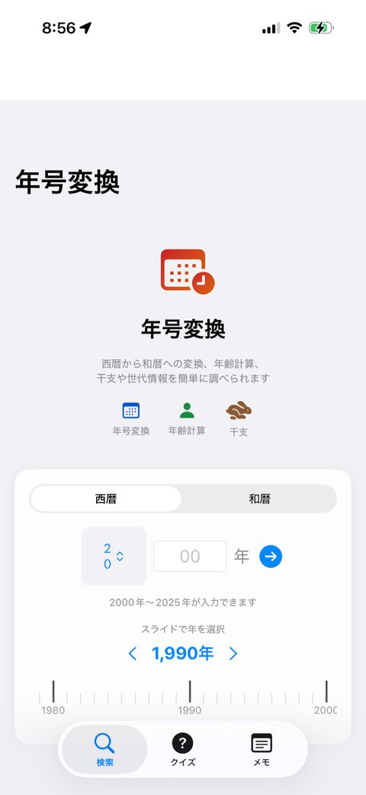
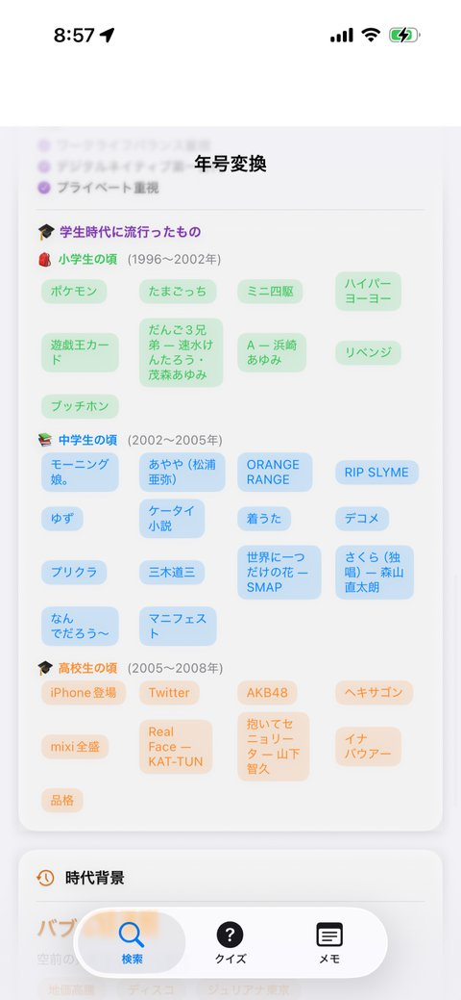
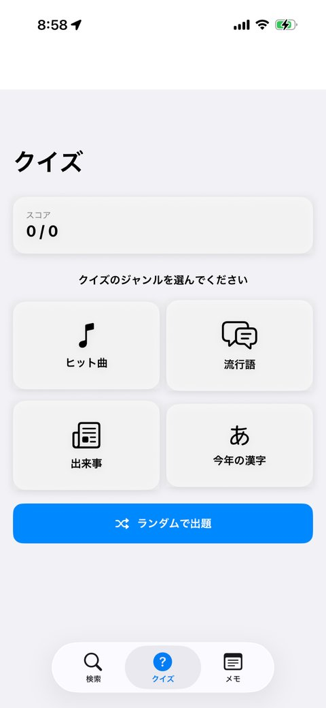

[暦変換AI](https://apps.apple.com/jp/app/%E6%9A%A6%E5%A4%89%E6%8F%9Bai/id6756545072) は、西暦と和暦を相互変換するiOSアプリです。個人開発の最初の1本で、このアプリをきっかけにアプリ開発の世界に入りました。

  <figure><figcaption>西暦と和暦を入れ替えて変換する基本画面</figcaption></figure>

## きっかけ

愛用していた暦変換アプリが突然配信終了してしまいました。代替アプリを探してみたものの、デザインや使い勝手がしっくりこなかったため、「それなら自分で作ってしまおう」と思い立ちました。

生成AIを活用した「バイブコーディング」でSwift未経験でもできるのでは？という直感もあり、最初のアプリとして選んだのがこれでした。

## 差別化のためのAI機能

暦変換だけなら既存アプリとの差別化が難しいため、AI機能を追加することにしました。

  <figure><figcaption>入力した年の流行や出来事をAIが教えてくれる</figcaption></figure>
  <figure><figcaption>年代ネタのクイズ機能</figcaption></figure>

その年の流行や出来事、世代あるあるをAIがコメントしてくれる機能です。たとえば「1985年」と入力すると、その年に関する話題をAIが語ってくれます。単なる変換ツールではなく、懐かしさや会話のきっかけになるような体験を目指しました。

また、家族の誕生日や記念日をメモとして登録しておけば、元号またぎの年齢計算や節目の年の確認がすぐにできる機能も付けています。

## 開発の流れ

コーディングのパートナーはClaude、言語はSwiftで、コーディング自体は1日程度で完成しました。ただし、シミュレータでのテスト環境の整備やApp Storeへの審査申請など、周辺の作業を含めると1ヶ月ほどのプロジェクトになりました。

審査員からの指摘に対しても、生成AIに相談しながら対応できました。やり取りは日本語で進めてもらえたのも助かりました。

個人開発の最初の1本として、小さな不便を解消するところから始められたことは今でも良い出発点だったと思っています。

[App Storeで見る](https://apps.apple.com/jp/app/%E6%9A%A6%E5%A4%89%E6%8F%9Bai/id6756545072)
