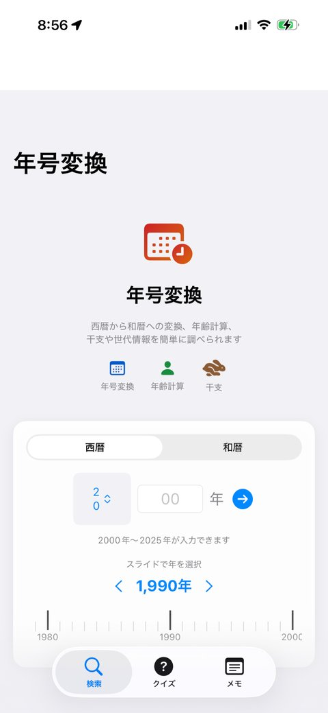
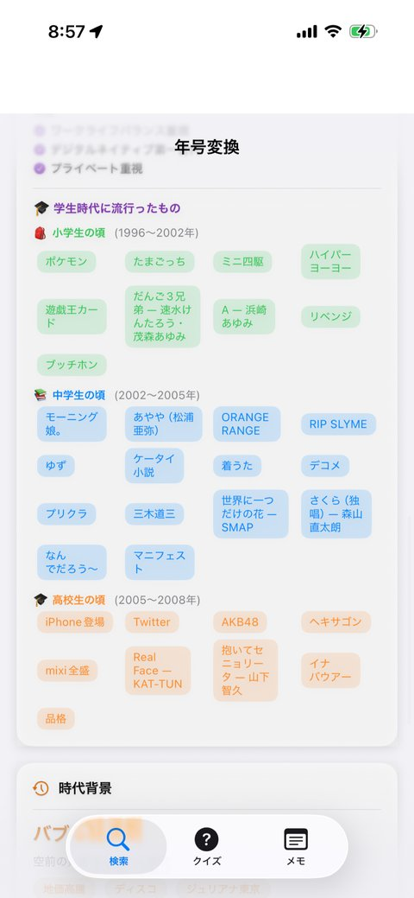
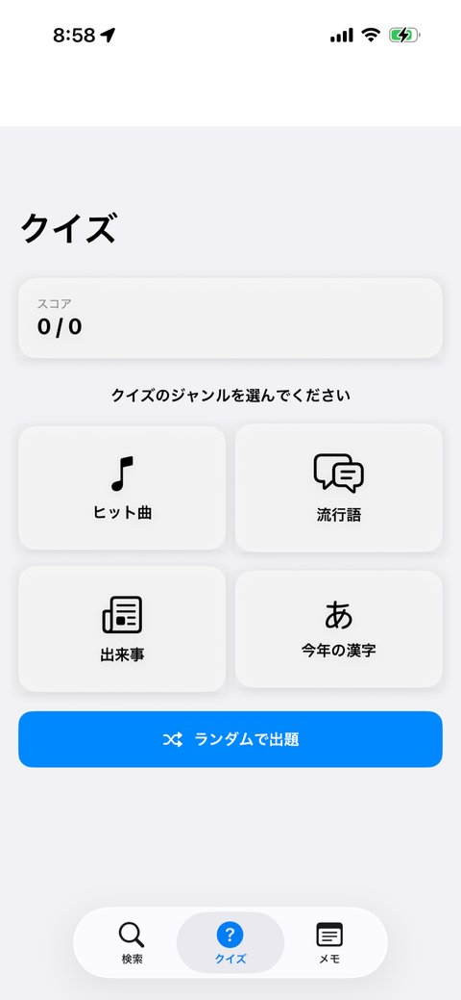

[暦変換AI](https://apps.apple.com/jp/app/%E6%9A%A6%E5%A4%89%E6%8F%9Bai/id6756545072) は、西暦と和暦を相互変換するiOSアプリです。個人開発の最初の1本で、このアプリをきっかけにアプリ開発の世界に入りました。

  <figure><figcaption>西暦と和暦を入れ替えて変換する基本画面</figcaption></figure>

## 目次

- [きっかけ](#きっかけ)
- [差別化のためのAI機能](#差別化のためのai機能)
- [変換のしくみ](#変換のしくみ)
- [結果カードと内蔵の年データ](#結果カードと内蔵の年データ)
- [AI機能の中身](#ai機能の中身)
- [クイズとメモ](#クイズとメモ)
- [できないことと注意点](#できないことと注意点)
- [開発の流れ](#開発の流れ)
- [公開後に足したもの](#公開後に足したもの)

## きっかけ

愛用していた暦変換アプリが突然配信終了してしまいました。代替アプリを探してみたものの、デザインや使い勝手がしっくりこなかったため、「それなら自分で作ってしまおう」と思い立ちました。

生成AIを活用した「バイブコーディング」でSwift未経験でもできるのでは？という直感もあり、最初のアプリとして選んだのがこれでした。

## 差別化のためのAI機能

暦変換だけなら既存アプリとの差別化が難しいため、AI機能を追加することにしました。

  <figure><figcaption>入力した年の流行や出来事をAIが教えてくれる</figcaption></figure>
  <figure><figcaption>年代ネタのクイズ機能</figcaption></figure>

その年の流行や出来事、世代あるあるをAIがコメントしてくれる機能です。たとえば「1985年」と入力すると、その年に関する話題をAIが語ってくれます。単なる変換ツールではなく、懐かしさや会話のきっかけになるような体験を目指しました。

また、家族の誕生日や記念日をメモとして登録しておけば、元号またぎの年齢計算や節目の年の確認がすぐにできる機能も付けています。

## 変換のしくみ

画面は「検索」「クイズ」「メモ」の3つのタブに分かれています。変換は「検索」タブで行い、入力方法を西暦と和暦で切り替えられます。

西暦で入力する場合は、上2桁（世紀）を選んでから下2桁を打ち込む形にしました。4桁すべてを打つより手数が少なく、「85」と入れるだけで1985年を調べられます。年をスクロールで選ぶピッカーも用意しています。受け付ける範囲は1900年から2050年までで、未来の年も変換できます。

和暦で入力する場合は、明治・大正・昭和・平成・令和から元号を選び、年数を入力します。元号を選ぶと「昭和: 1926年〜1988年（元年〜63年）」のように対応する西暦の範囲が表示されるので、どこまで入力できるかがその場で分かります。

変換の計算そのものは単純で、各元号の開始年を表として持っておき、次の式で求めています。

| 方向 | 計算 |
|---|---|
| 西暦 → 和暦 | 西暦 − 元号の開始年 + 1（1 のときは「元年」と表示） |
| 和暦 → 西暦 | 元号の開始年 + 年数 − 1 |
| 十二支 | 2020年を子年として、差を12で割った余りから求める |

年齢は、生まれ年に加えて誕生月日と「指定日」を入れると、その日時点での年齢を「◯歳◯ヶ月」の形で表示します。指定日は今日以外にも動かせるので、「入学式の日に何歳か」「定年の日に何歳か」といった確認に使えます。この年齢の計算は、西暦（グレゴリオ暦）のカレンダーを明示して行っています。

## 結果カードと内蔵の年データ

変換結果は、次の6種類のカードで表示されます。

- 基本情報（西暦・和暦・年齢）
- 十二支
- その年の情報
- 世代
- 時代背景
- AI機能

カードの並び順は並べ替え用の画面でドラッグして入れ替えられ、順番は端末に保存されます。年齢だけ見たい人と、その年の出来事を先に見たい人とで、使い方が違うと考えたためです。

「その年の情報」カードの中身は、アプリに内蔵している年ごとのデータです。1960年から2025年までの66年分について、ヒット曲、流行語、国内と海外の主な出来事、総理大臣、平均年収を収録しています。「今年の漢字」は発表が始まった1995年以降の分が入っています。通信して取得しているわけではないので、電波のない場所でも表示できます。

ヒット曲や流行語はタグとして並び、タップすると Google・Wikipedia・YouTube で検索するメニューが開きます（曲の場合は Apple Music も選べます）。アプリの中の説明は短くとどめ、詳しく知りたいときは外で調べてもらう、という割り切りです。

「世代」カードは生まれ年から世代名（バブル世代、氷河期世代、ゆとり世代、Z世代など）を引き、小学生・中学生・高校生だった頃に流行していたものも合わせて表示します。

## AI機能の中身

AI機能には、Apple が iOS 26 から提供している Foundation Models（端末内で動く言語モデル）を使っています。外部のAIサービスに文章を送る方式ではないため、入力した年や名前がAIのために外へ送信されることはありません。

生成できる内容は次の5種類です。

| 種類 | 内容 |
|---|---|
| その年あるある | その年生まれならではの話題を3つ |
| 誕生日メッセージ | 世代や干支を織り込んだメッセージを3パターン |
| 会話のきっかけ | その世代と盛り上がりそうな話題を5つ |
| 干支性格診断 | 干支をもとにした、読み物としての性格解説 |
| 世代間ギャップ | 2つの生まれ年を比べ、価値観の違いと共通点を解説 |

工夫した点は、AIに年だけを渡すのではなく、内蔵データから「その年のヒット曲・流行語・出来事」「学生時代の流行」「世代名」「時代背景」「干支」を抜き出して、質問文と一緒に渡していることです。端末内の小さなモデルは年ごとの細かい事実が苦手なので、手元のデータを材料として与え、文章にまとめる役に専念してもらう形にしました。

同じ年・同じ種類の結果は1時間のあいだメモリに保持し（最大50件）、もう一度開いたときは生成し直さずに表示します。また、バッテリー残量が10%未満で充電していないときは、AI機能を止めて理由を表示するようにしています。

## クイズとメモ

「クイズ」タブは、内蔵の年データから問題をその場で組み立てる4択クイズです。ジャンルはヒット曲・流行語・出来事・今年の漢字の4種類で、正解の年とは別の年のデータを誤答の選択肢に使っています。直近8問の正解と同じ答えの問題はなるべく出さないようにしており、続けて遊んでも同じ問題ばかりになりにくくしました。正解数と正答率も表示されます。

「メモ」タブでは、名前・生年月日・ひとことメモを登録できます。一覧には現在の年齢と次の誕生日までの日数が表示され、詳細画面では和暦・十二支・世代もまとめて確認できます。検索結果の画面から「この結果をメモに保存」で直接登録でき、内容をテキストとしてコピーすることもできます。メモは端末内のデータベース（SwiftData）に保存しています。

## できないことと注意点

- 変換は「年」単位です。改元のあった年は新しい元号で表示します。たとえば1989年は「平成元年」になり、1989年1月7日までの「昭和64年」は扱いません。2019年の4月以前（平成31年）も同じです。
- 和暦の入力は明治以降、西暦の入力は1900年以降が対象です。
- ヒット曲や出来事などの詳細データがあるのは1960年〜2025年です。それ以外の年は、和暦・十二支・年齢の変換だけになります。
- AI機能は iOS 26 以降の端末でのみ動きます。アプリ自体は iOS 17 から使え、AI以外の機能はそのまま利用できます。
- AIの文章は端末内のモデルが作るため、事実と違う内容が混ざることがあります。読み物として楽しむ位置づけです。
- 画面上部にバナー広告を表示しています。

## 開発の流れ

コーディングのパートナーはClaude、言語はSwiftで、コーディング自体は1日程度で完成しました。ただし、シミュレータでのテスト環境の整備やApp Storeへの審査申請など、周辺の作業を含めると1ヶ月ほどのプロジェクトになりました。

審査員からの指摘に対しても、生成AIに相談しながら対応できました。やり取りは日本語で進めてもらえたのも助かりました。

個人開発の最初の1本として、小さな不便を解消するところから始められたことは今でも良い出発点だったと思っています。

## 公開後に足したもの

リポジトリの履歴をたどると、最初の版のあとも細かい手直しを続けています。

- 2025年12月15日: 年データを見直して不足分を追加。タグをタップしてWeb検索できるメニューを追加。変換できる範囲を2050年まで拡大
- 2025年12月16日: iPad のレイアウトに対応。西暦の入力範囲を1900年以降に拡大
- 2025年12月19日: 日本語ローカライズを追加
- 2026年1月: アプリアイコンを見直し
- 2026年4月9日: 誕生月日と指定日を入れて、その日時点の年齢を表示する機能を追加

最後の「指定日時点の年齢」は、今日の年齢ではなく特定の日の年齢を知りたい、という使い方に合わせて入れたものです。変換そのものは数行の計算ですが、入力のしやすさや結果の見せ方には、まだ手を入れる余地があると感じています。

[App Storeで見る](https://apps.apple.com/jp/app/%E6%9A%A6%E5%A4%89%E6%8F%9Bai/id6756545072)
