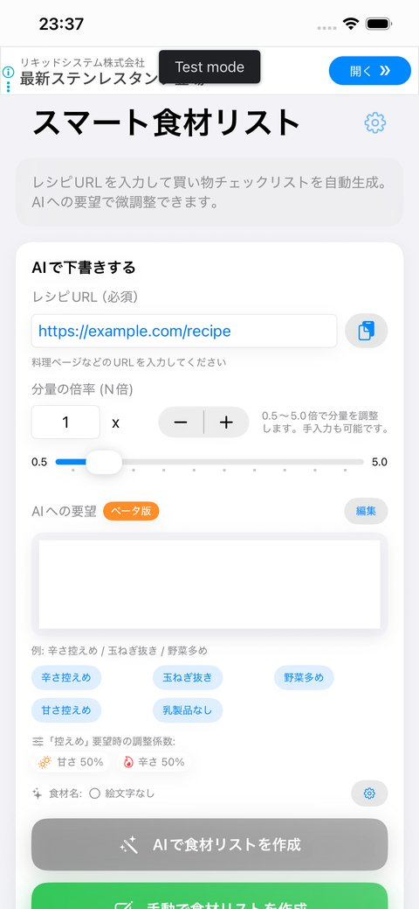
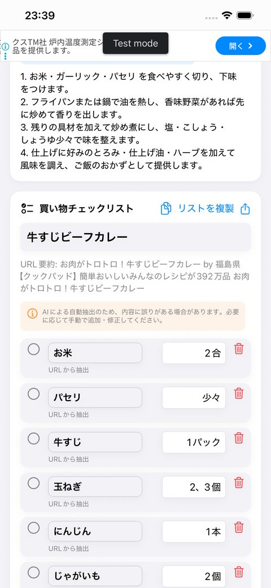
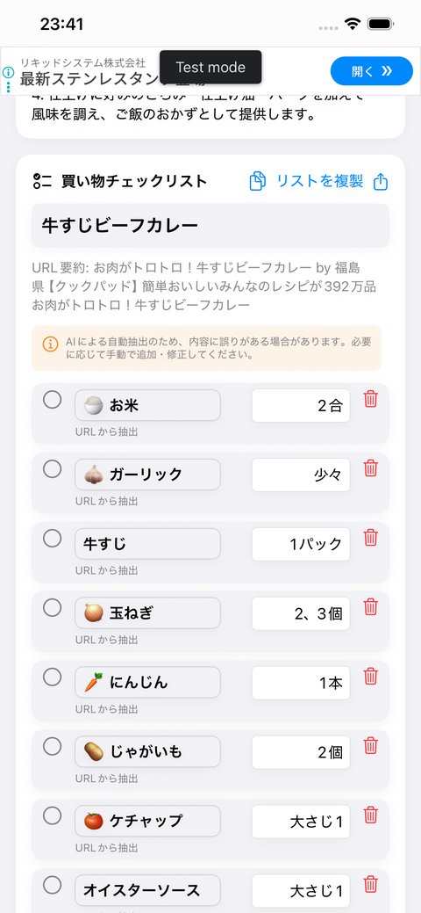

[スマート食材リスト](https://apps.apple.com/jp/app/%E3%82%B9%E3%83%9E%E3%83%BC%E3%83%88%E9%A3%9F%E6%9D%90%E3%83%AA%E3%82%B9%E3%83%88/id6757102546) は、レシピから必要な食材を自動でリストアップするiOSアプリです。

## 目次

- [きっかけ](#きっかけ)
- [こだわった機能](#こだわった機能)
- [使い方の流れ](#使い方の流れ)
- [食材を取り出すしくみ](#食材を取り出すしくみ)
- [分量の倍率と要望の反映](#分量の倍率と要望の反映)
- [リストの保存と共有](#リストの保存と共有)
- [データの扱い](#データの扱い)
- [できないことと注意点](#できないことと注意点)
- [開発の経過](#開発の経過)

## きっかけ

家族から「最近は動画やレシピサイトを参考に料理を作ることが多い」という話を聞いたことがきっかけです。レシピを見ながら食材を書き出す手間をなくせたら便利だと思い、作ることにしました。

## こだわった機能

**AIによる食材の自動リストアップ**
レシピページのURLを入力すると、AIが必要な食材を自動で抽出してリスト化します。材料を手で書き写す手間が省けます。

  <figure><figcaption>レシピのURLと分量の倍率を入れるだけ</figcaption></figure>
  <figure><figcaption>AIが抽出した食材が買い物チェックリストになる</figcaption></figure>
  <figure><figcaption>食材名に絵文字が付いてひと目で分かる</figcaption></figure>

**分量のカスタマイズ**
「塩分控えめ」「2人分を4人分に変更」といった要望に合わせて分量を調整できます。家族の人数や好みに合わせて柔軟に使えるようにしました。

**絵文字で見た目にわかりやすく**
食材名に絵文字を付けて、リストを視覚的にわかりやすくする工夫を取り入れました。文字だけのリストより直感的に確認できます。

買い忘れや二重買いを減らすことを目標に、日常の買い物をシンプルにするアプリを目指しました。

## 使い方の流れ

1. レシピページのURLを貼り付けます（URLは必須です）。
2. 分量の倍率を選びます。0.5倍から5.0倍まで0.5刻みで、ボタン・スライダー・手入力のどれでも指定できます。
3. 必要なら「AIへの要望」を入れます。「辛さ控えめ」「玉ねぎ抜き」「野菜多め」「甘さ控えめ」「乳製品なし」は最初からボタンとして並んでいて、自分の言い回しを追加・編集することもできます。
4. 「AIで食材リストを作成」を押すと、料理名をタイトルにした買い物チェックリストと、手順をまとめたレシピ欄ができあがります。
5. 店ではチェックを付けながら買い物をします。足りない品目は、名前と分量を入れて手動で追加できます。

AIを使わず、空のリストから手で作ることもできます。

## 食材を取り出すしくみ

AIには、Apple が iOS 26 から提供している Foundation Models（端末内で動く言語モデル）を使っています。レシピの文章を外部のAIサービスへ送ることはなく、通信はレシピページを読み込むところだけです。

ただ、ページの文章を端末内のモデルに渡して「材料を抜き出して」と頼むだけの作りにはしていません。開発の途中では、AIが食材を誤って落としてしまう問題への対策を何度か入れており、最終的に次のように役割を分けています。

| 段階 | 担当 | 内容 |
|---|---|---|
| ページの取得 | 通常の通信／WebKit | HTMLを取得する。クックパッドのページは、Webビューで読み込んでJavaScript実行後のHTMLを取得する（10秒で打ち切り） |
| 材料欄の解析 | プログラム | ページ内の構造化データ（JSON-LD の recipeIngredient など）や、サイトごとの材料欄のHTMLから、食材名と分量を取り出す |
| 下書きの生成 | 端末内AI | 料理名、食材、手順の要約をJSONで出力する。AIに渡す本文は先頭1,500文字、食材は最大15件に絞っている |
| 分量の補正 | プログラム | AIの出した分量が空・「適量」・単位のない数字だけのときは、ページから読み取れた分量で埋め直す |
| 食材でないものの除外 | 端末内AI | 調理器具や「2人分」のような見出しが混ざっていないかを判定する |

材料欄の解析は、クックパッド、クラシル、DELISH KITCHEN、Nadia、楽天レシピ、味の素パーク、NHK「きょうの料理」など、サイトごとのページ形式に合わせた処理を持っています。YouTube のURLを入れた場合は、動画の概要欄の文章を材料の情報源として使います。

AIへの指示文では、「分量を推測で書かない」「ページにない食材を足さない」「『適量』『少々』は書かれているとおりに残す」ことを明記しています。買い物リストは多少そっけなくても、書かれていないものが増えない方が役に立つと考えたためです。

## 分量の倍率と要望の反映

倍率の計算はAIに任せず、文字列を解析して数値だけを掛け算しています。対応している書き方は次のとおりです。

| 元の分量 | 2倍にした結果 | 補足 |
|---|---|---|
| 200g | 400g | 数字＋単位（g、ml、個、本、枚、パックなど） |
| 大さじ1 | 大さじ2 | 「大さじ」「小さじ」が前に付く形 |
| 1/2個 | 1個 | 分数は小数に直してから計算 |
| 2〜3枚 | 4〜6枚 | 幅のある書き方は両方を計算 |
| 適量・少々 | そのまま | 数値でないものは変えない |

結果は小数第2位までに丸め、整数になる場合は整数で表示します。

要望の反映には2つの経路があります。ひとつはAIが要望を読み取って、「除く食材」「分量を変える食材と倍率」「食材ごとの補足メモ」を指示として返す経路。もうひとつは、AIがその指示を返さなかったときにプログラム側で文言を照合する経路で、「玉ねぎ抜き」のように食材名と「抜き・なし・不使用」などの言葉が一緒に出てきたら、その食材をリストから外します。

「甘さ控えめ」については、砂糖・はちみつ・みりんの分量に設定画面の係数（初期値は50%）を掛け、メモ欄に「甘さ控えめで調整」と書き添えます。係数は10%〜100%の範囲で変えられます。

食材名の絵文字は、設定で「絵文字を含めて項目名を生成」をオンにしたときに付きます。ベータ版の扱いで、初期状態はオフです。チェックリスト上の表示では、食材名からルールで絵文字を決め、ルールに当てはまらないものだけAIに尋ねる二段構えにしています。

## リストの保存と共有

作ったリストは端末内に保存され、「保存済みリスト」からいつでも開き直せます。元のレシピのURLも一緒に残るので、リストからブラウザでレシピを開けます。

よく使う組み合わせは「プリセット化」しておくと、次回は「適用」ボタンから呼び出せます。リストの複製もできます。

共有の形式は用途に合わせて選べます。

- Markdownのチェックリストとして共有
- 共有シート経由でメモアプリやメールへ送る
- テキストとしてコピー（チェック状態あり／なし）

家族にメッセージで送る、メモアプリに貼っておく、といった使い方を想定しています。

## データの扱い

- リスト、プリセット、食材のチェック状態は端末内のデータベース（SwiftData）に保存します。
- 文字サイズ、甘さ・辛さの係数、絵文字の有無、要望のプリセットは端末内の設定として保存します。
- AIの処理は端末内で行います。
- 広告（Google AdMob）を表示しています。2026年1月の変更で、トラッキング許可のダイアログ（ATT）を出す処理をアプリから取り除きました。
- 設定画面の「初期化」で、リストとプリセットをまとめて削除できます。

## できないことと注意点

- AIでの生成にはレシピのURLが必要です。料理名だけを入れて材料を考えてもらう使い方には、現在対応していません。
- AIによる下書きは iOS 26 以降の端末で動きます。それより前のiOSでは、ページの材料欄を解析した結果をもとにリストを作ります。
- ページの作りによっては材料を読み取れないことがあります。リストの上にも「AIによる自動抽出のため、内容に誤りがある場合があります」と表示しており、手動での追加・修正を前提にしています。
- 「AIへの要望」と絵文字付きの項目名は、アプリ内でもベータ版と表示している機能です。
- 1回の生成で扱う食材は最大15件です。材料の多いレシピでは、足りない分を手動で足してください。

## 開発の経過

リポジトリの履歴では、最初の版を2025年12月下旬に登録しています。その後の1週間は、ほぼ抽出の精度の手直しでした。HTMLの構造から材料を読む処理の追加、食材でないものの除外の強化、粉類の分量に合う単位の選び方、DELISH KITCHEN のページへの対応、AIが食材を誤って落とす問題への対策などです。絵文字の割り当てルール（砂糖や小麦粉、みりんにどの絵文字を当てるか）も、この時期に何度か直しています。

AIに丸ごと任せるより、機械的に読めるところはプログラムで読み、AIには要約と判定を任せる。その分担に落ち着くまでの試行錯誤が、このアプリの開発のほとんどを占めました。

日々の買い物を少しでもラクにできるツールとして、気に入って使ってもらえたら嬉しいです。

[App Storeで見る](https://apps.apple.com/jp/app/%E3%82%B9%E3%83%9E%E3%83%BC%E3%83%88%E9%A3%9F%E6%9D%90%E3%83%AA%E3%82%B9%E3%83%88/id6757102546)
