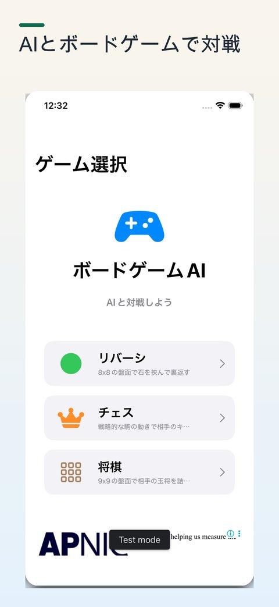
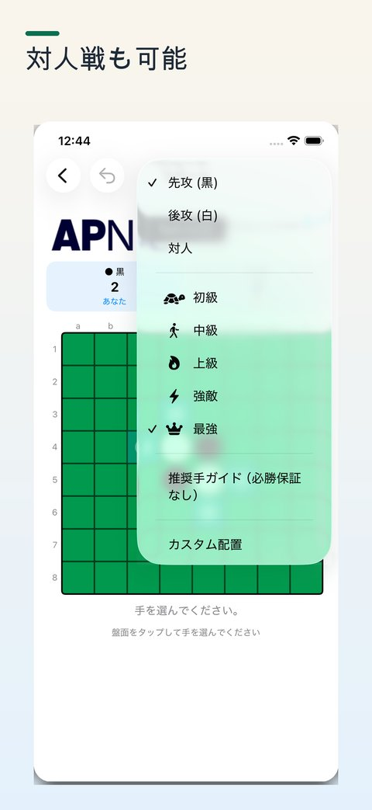
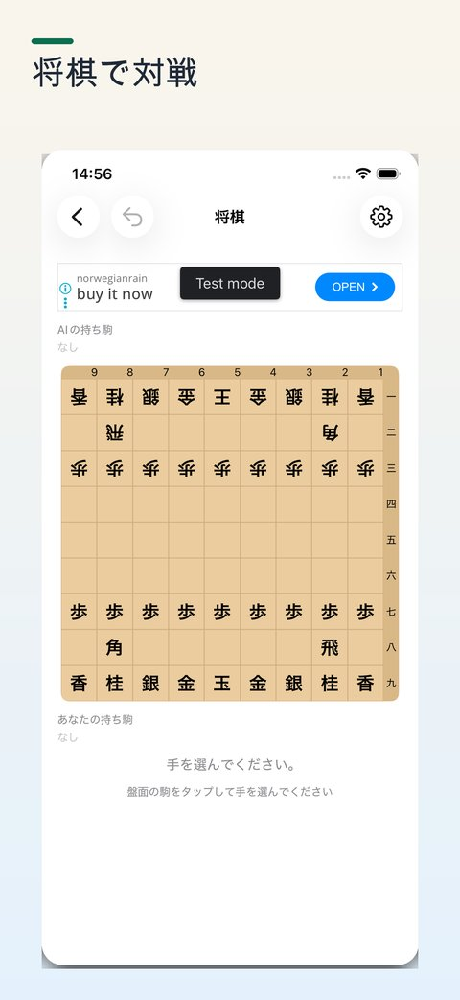

[ボードゲームAI](https://apps.apple.com/jp/app/boardgameai/id6759185448) は、リバーシ・チェス・将棋の3タイトルをまとめたiOSアプリです。AI対戦と対人戦の両方に対応しています。

  <figure><figcaption>リバーシ・チェス・将棋を1本にまとめたゲーム選択画面</figcaption></figure>

## 目次

- [なぜ3タイトルを1本にまとめたか](#なぜ3タイトルを1本にまとめたか)
- [AIの強さ調整に苦労した](#aiの強さ調整に苦労した)
- [5段階の強さの中身](#5段階の強さの中身)
- [盤面をどう評価しているか](#盤面をどう評価しているか)
- [学習アプリとしての側面](#学習アプリとしての側面)
- [カスタム配置で練習する](#カスタム配置で練習する)
- [対応しているルールと操作](#対応しているルールと操作)
- [旅先の暇つぶしに](#旅先の暇つぶしに)
- [できないことと注意点](#できないことと注意点)
- [開発の経過](#開発の経過)

## なぜ3タイトルを1本にまとめたか

ゲームごとにアプリを切り替えるのが面倒だという、シンプルな動機からです。どうせ作るなら共通のUIや基本機能をまとめて、1本で完結するようにしました。見た目や操作感を統一することで、ゲームが変わっても迷わず使えます。

## AIの強さ調整に苦労した

AI対戦の強さ設定は、想像以上に難しい問題でした。「強い・普通・弱い」を自然に感じてもらうには、AIが単純に最善手を打つだけでは強すぎるし、ランダムに手を選ぶだけでは弱すぎます。

  <figure><figcaption>初級から最強までの強さと先手・後手をメニューで選ぶ</figcaption></figure>

最終的に採用した方法は、**AIの手に制約をつけること**です。強さのレベルに応じて選択できる手の範囲を絞ることで、自然な強弱を表現しました。

## 5段階の強さの中身

強さは「初級・中級・上級・強敵・最強」の5段階で、選んだレベルは端末に保存されます。レベルごとに、手の選び方そのものを変えています。

| レベル | 手の選び方 |
|---|---|
| 初級 | 指せる手の中からランダムに選ぶ。リバーシでは、角が取れる場面でもあえて角以外を選ぶ |
| 中級 | 決まった優先順位で選ぶ。リバーシは「角 → 辺 → 角の隣を避けた手」、チェスは「価値の高い駒を取る手 → 中央へ進む手」、将棋は「駒を取る手 → 成る手 → 中央へ進む手」 |
| 上級 | すべての手に点数を付けて最高点の手を選ぶ。リバーシと将棋では1手先まで先読みする |
| 強敵 | 先読み探索。リバーシは3手先、チェスと将棋は2手先まで |
| 最強 | 先読み探索。リバーシは5手先、チェスと将棋は3手先まで |

先読みには、ゲームAIの定番であるミニマックス法と、読む必要のない枝を打ち切るアルファベータ法を使っています。相手は自分にとって最も困る手を指してくる、と仮定して数手先の局面を比べる方法です。

スマホで待たされないことも大事なので、考える時間には上限を付けました。リバーシは3秒、チェスは強敵で1.2秒・最強で1.8秒、将棋は強敵で1.0秒・最強で1.5秒です。チェスと将棋では、指せる手が多い局面（チェスは19手以上、将棋は23手以上）で読む深さを1段浅くし、チェスは点数の高い候補だけに絞って読み進めます。冒頭で書いた「選択できる手の範囲を絞る」は、弱いレベルを自然に見せるためだけでなく、強いレベルを時間内に動かすためにも使っています。

もうひとつの工夫は序盤です。チェス（強敵・最強）と将棋（上級以上）では、対局開始から12手までは点数の高い上位5手の中からランダムに1手を選びます。毎回まったく同じ出だしになるのを避けつつ、すぐに指し返すためです。

## 盤面をどう評価しているか

先読みをしても、行き着いた局面が良いのか悪いのかを数字にできなければ手を選べません。この「評価」の作り方はゲームごとに違います。

リバーシは、マスごとに重みを持たせた表を使っています。角は+100、角の斜め隣は−40、角の縦横の隣は−20という具合で、序盤から石をたくさん取るより、良い場所を押さえることを重く見ます。これに「次に打てる場所の数の差」を加点し、盤上の石が50個を超えた終盤だけ石の数の差を強く効かせています。序盤は打てる場所の多さ、終盤は枚数、という切り替えです。

チェスは駒の価値の合計が土台です。ポーン100、ナイト320、ビショップ330、ルーク500、クイーン900として数えます。そのうえで、手を比べるときに、指した直後に取り返されて損をする手には減点を入れています。

将棋も駒の価値が土台ですが、持ち駒を打てるぶん局面が荒れやすいので、追加の安全策を入れました。飛車や角をただで取られる手を探索が選んでしまったときは、大駒が安全な別の候補に差し替えます。同じ手順をぐるぐる繰り返す手を避ける処理も入れています。

## 学習アプリとしての側面

せっかくAIを使うなら、対局するだけでなく学びにもなるように、とAIの思考プロセスを表示する機能を追加しました。AIがなぜその手を選んだかを確認できるため、強さの秘訣をユーザーが学べる仕掛けになっています。純粋なゲームアプリでありながら、上達のヒントを得られる学習アプリでもあります。

  <figure><figcaption>将棋の対局画面。AIの考えも表示できる</figcaption></figure>

学びに使える機能は、思考の表示のほかに3つあります。

- **推奨手ガイド**: メニューでオンにすると、自分の番にAIのおすすめの手と、「要警戒」として相手の最善の応手を表示します。あくまで数手読んだ範囲での候補なので、画面にも「必勝保証なし」と書いています。
- **対局後の解説**: 終局すると、決め手になった手、その場面での改善手、学べるポイント、次回の目標をまとめた講評が出ます。講評に出てきた「◯手目」の直前まで盤面を戻して、そこから指し直すこともできます。
- **戻す**: 対局中に手を取り消せます。

リバーシでは、先読みを使うレベルのとき、選んだ手に加えて理由と関連する定石のヒントを表示します。「角を確保して安定石を作れます」「相手をパスに追い込めます」といった理由は、返せる石の数や、打った後に自分と相手が打てる場所の数をプログラムで数えて組み立てています。iOS 26 以降の端末では、その材料を端末内の言語モデル（Apple の Foundation Models）に渡して1文に要約させています。対局後の講評も同じモデルで作っており、使えない端末では定型の講評に切り替わります。

言語モデルに任せているのは説明文と配置の読み取りだけで、対局中の手そのものは上で書いた探索と評価で決めています。

## カスタム配置で練習する

メニューの「カスタム配置」から、初期配置を変えて対局を始められます。あらかじめ用意したボタンは次のとおりです。

| ゲーム | 用意している配置 |
|---|---|
| リバーシ | 4隅に黒を配置／中央を黒で囲む／ランダムに石を配置 |
| チェス | クイーンなし／ルークなし／ポーンなし／ナイトとビショップなし |
| 将棋 | 角落ち／飛車落ち／二枚落ち／四枚落ち／六枚落ち |

これらは決め打ちの配置としてアプリに持っているので、どの端末でも使えます。将棋の駒落ちで強い相手とのハンデ戦を試す、リバーシで角を取られた状態からの立て直しを練習する、といった使い方ができます。

ボタンにない配置は、文章で指示できます（iOS 26 以降）。端末内の言語モデルに盤面を決まった書式で出力させ、それを読み取って盤に並べています。リバーシとチェスでは、書式が崩れていたら1回だけ出し直しを頼み、それでも読めなければエラーを表示します。

## 対応しているルールと操作

- **リバーシ**: 8×8の盤。打てるマスの表示と、石数のリアルタイム表示があります。
- **チェス**: キャスリング、アンパッサン、プロモーションに対応しています。チェックメイトとステイルメイトを判定します。
- **将棋**: 成る・成らないの選択、持ち駒を打つ操作、王手の表示に対応しています。二歩は打てないようにしています。

どのゲームも、メニューから「先攻」「後攻」「対人」を切り替えられます。

## 旅先の暇つぶしに

スマホ1台あれば対人戦もできるので、出かけた先での暇つぶしに使えることを意識して設計しました。機材なしでゲームを楽しみたい場面で役立てばと思っています。

道具なし・場所を選ばずに遊べるアプリとして、旅先や待ち時間に活用してもらえればと思っています。

## できないことと注意点

- 対人戦は1台の端末を交互に操作する形です。通信での対戦機能はありません。
- 「最強」でも、読むのはリバーシで5手先、チェスと将棋で3手先までです。考える時間に上限があるため、専用の対局ソフトのような強さではありません。
- 推奨手ガイドと対局後の講評は、上達のヒントとして見てもらうものです。講評は言語モデルが書くため、内容が正確でないことがあります。
- 文章でのカスタム配置と、言語モデルによる講評は iOS 26 以降で動きます。アプリ自体は iOS 17 から使え、対局とプリセットの配置はそのまま利用できます。
- 広告を表示しています。「もう一度遊ぶ」を押したときにも広告が出ます。

## 開発の経過

リポジトリの履歴では、最初にリバーシとチェスの2つで形を作り、同じ日のうちに「手を戻す」機能と思考の表示、将棋を加えています（2026年2月14日）。その後、強さの設定の保存、カスタム配置の改良、盤や駒の見やすさの調整を重ね、2月19日にAIと画面をまとめて見直しました。4月にはアプリ名の表記を「ボードゲームAI」にそろえ、バージョンを1.1にしています。

ルールを実装するところまでは早く進みましたが、時間がかかったのは「弱すぎず強すぎない相手」と「待たされない応答」を両立させる調整でした。先読みの深さ、時間の上限、候補の絞り込みを少しずつ動かして、今の5段階に落ち着いています。

[App Storeで見る](https://apps.apple.com/jp/app/boardgameai/id6759185448)
