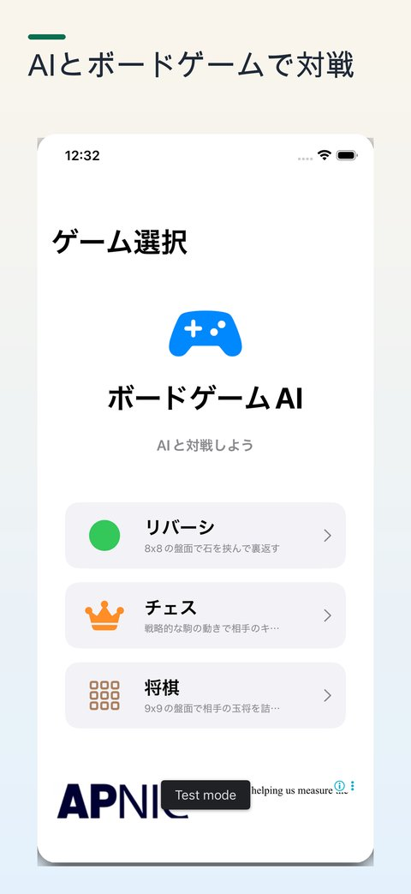
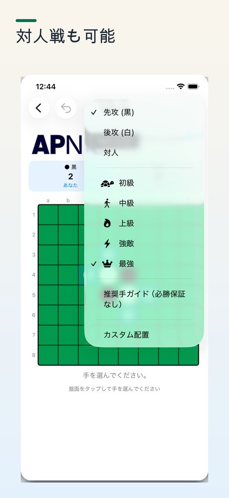
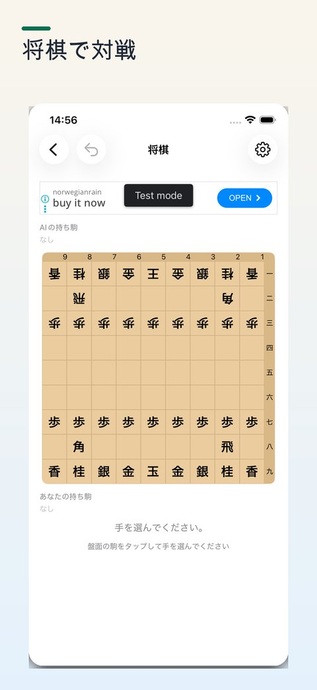

[ボードゲームAI](https://apps.apple.com/jp/app/boardgameai/id6759185448) は、リバーシ・チェス・将棋の3タイトルをまとめたiOSアプリです。AI対戦と対人戦の両方に対応しています。

  <figure><figcaption>リバーシ・チェス・将棋を1本にまとめたゲーム選択画面</figcaption></figure>

## なぜ3タイトルを1本にまとめたか

ゲームごとにアプリを切り替えるのが面倒だという、シンプルな動機からです。どうせ作るなら共通のUIや基本機能をまとめて、1本で完結するようにしました。見た目や操作感を統一することで、ゲームが変わっても迷わず使えます。

## AIの強さ調整に苦労した

AI対戦の強さ設定は、想像以上に難しい問題でした。「強い・普通・弱い」を自然に感じてもらうには、AIが単純に最善手を打つだけでは強すぎるし、ランダムに手を選ぶだけでは弱すぎます。

  <figure><figcaption>初級から最強までの強さと先手・後手をメニューで選ぶ</figcaption></figure>

最終的に採用した方法は、**AIの手に制約をつけること**です。強さのレベルに応じて選択できる手の範囲を絞ることで、自然な強弱を表現しました。

## 学習アプリとしての側面

せっかくAIを使うなら、対局するだけでなく学びにもなるように、とAIの思考プロセスを表示する機能を追加しました。AIがなぜその手を選んだかを確認できるため、強さの秘訣をユーザーが学べる仕掛けになっています。純粋なゲームアプリでありながら、上達のヒントを得られる学習アプリでもあります。

  <figure><figcaption>将棋の対局画面。AIの考えも表示できる</figcaption></figure>

## 旅先の暇つぶしに

スマホ1台あれば対人戦もできるので、出かけた先での暇つぶしに使えることを意識して設計しました。機材なしでゲームを楽しみたい場面で役立てばと思っています。

道具なし・場所を選ばずに遊べるアプリとして、旅先や待ち時間に活用してもらえればと思っています。

[App Storeで見る](https://apps.apple.com/jp/app/boardgameai/id6759185448)
