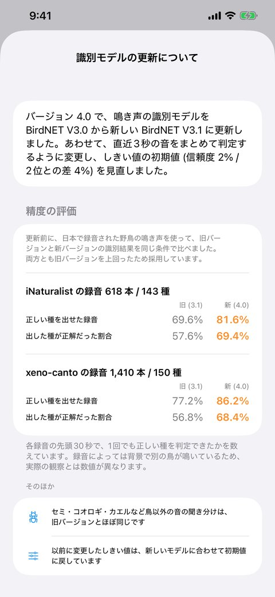
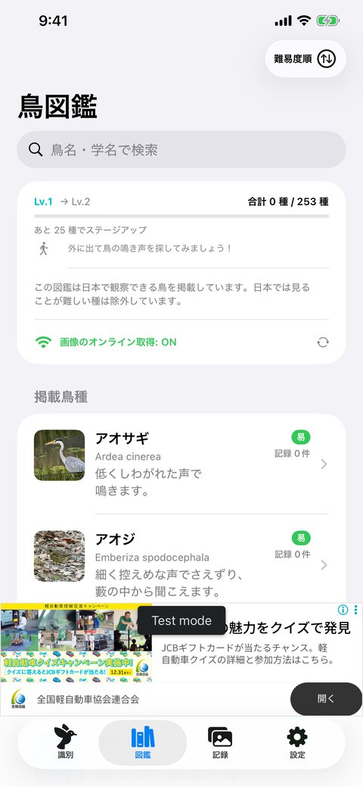

[野鳥鳴き声サーチ](https://apps.apple.com/jp/app/%E9%87%8E%E9%B3%A5%E9%B3%B4%E3%81%8D%E5%A3%B0%E3%82%B5%E3%83%BC%E3%83%81/id6761675286) は、録音した鳴き声から野鳥の種類を推定するiOS / Androidアプリです。趣味の野鳥撮影から生まれたアプリです。この記事では、作った経緯に加えて、識別がどう動いているか、設定の意味、記録の残し方までまとめます。

  <figure><figcaption>録音しながらその場で鳥種を推定する識別画面</figcaption></figure>

## 目次

- [最初の構想と現実](#concept)
- [オフラインで使えることへのこだわり](#offline)
- [識別の流れ](#pipeline)
- [識別設定の読み方](#settings)
- [バージョン4.0での精度の見直し](#eval)
- [カエルや蝉も識別できる](#non-bird)
- [図鑑・観察記録として使える](#records)
- [機種変更時のデータ引き継ぎ](#backup)
- [通信とデータの扱い](#privacy)
- [苦手な場面](#limits)
- [これまでの更新](#history)

## 最初の構想と現実 {#concept}

最初に思い描いていたのは、もっと野心的なアプリでした。カメラやマイクを使って、野鳥の位置をリアルタイムで特定するようなものです。実際、開発の最初期には、端末を一周させて鳴き声のする方角を探すレーダー表示の画面を試作しています。

ただ、実際に検討してみると難しい壁がいくつもありました。野鳥は木の陰に隠れていて見えないことが多く、スマホのマイクでは音の方向まで把握するのは難しい。現実的なラインを考えた結果、「何の鳥かがわかる」ところを目指すことにしました。現在のアプリは「識別」「図鑑」「記録」「設定」の4つのタブで構成しています。

識別の方法も一度で決まったわけではありません。周波数の特徴で判定する方法、見本の鳴き声との照合、公開されている録音を集めて54種を学習させた自作の分類モデルと順に試し、最終的にBirdNETを使う形に落ち着きました。途中で使っていた補助の分類器や見本音声は、後のバージョンで取り除いて構成を単純にしています。

## オフラインで使えることへのこだわり {#offline}

野鳥観察の現場は山中であることも多く、電波が入らない場所でも使えることが実用上の必須条件でした。AIモデルをアプリに内蔵することでオフライン動作を実現しています。

  <figure><figcaption>識別モデルの精度評価もアプリ内で確認できる</figcaption></figure>

ベースにしたのはコーネル大学が開発した **BirdNET** で、日本で見られる種に絞り込んだうえでFP16化して軽量化しています。バージョン3.0でBirdNET V3.0に、4.0でV3.1に差し替えました。モデルの絞り込みや軽量化の詳細は[こちらの記事](/blog/2026/06/17/bird-voice-search-tech/)にまとめています。

## 識別の流れ {#pipeline}

識別タブを開いている間、アプリは次の順で処理を続けています。

1. マイクの音を取り込み、モデルが想定する32kHzに変換します。
2. 音量と、鳥の声が集まりやすい1〜8kHzの帯域の強さを見て、鳴き声らしい音かどうかを判断します。
3. 直近3秒ぶんの音をモデルに渡します。推論は最短1.5秒おきで、前回と重なる区間を含めて判定します。起動直後で音が3秒に満たないときは、足りない部分を無音で埋めます。
4. 1位の候補の確率（信頼度）と、2位との差がどちらもしきい値を超えたときだけ、種名を確定して表示します。
5. 確定しなかった場合も含め、上位の候補を一覧で見られます。

3の「重ねて判定する」方式は4.0で入れたものです。それまでは約1.5秒の新しい音に無音を足して推論していましたが、直近3秒をまとめて渡すほうが正解率が高いことを評価で確かめて切り替えました。

個別の調整も入れています。ムクドリはモズやジョウビタキ、オオヨシキリなど声の似た種と取り違えやすいので、ムクドリの点数を少し持ち上げ、僅差のときはムクドリを優先し、候補一覧にもムクドリを残すようにしています。

## 識別設定の読み方 {#settings}

設定タブの「識別設定」では、識別の厳しさを自分で調整できます。迷ったら「おすすめ設定を適用」を押せば既定値に戻ります。

| 項目 | 範囲 | 既定 | 変えるとどうなるか |
|---|---|---|---|
| 検出感度 | 10段階 | 高 | 下げると小さな音に反応しにくくなります |
| 分析バッファ | 0.5〜3.0秒 | 1.0秒 | 短いほど反応が速く、精度は下がることがあります |
| 分類信頼度しきい値 | 0〜80% | 2% | 下げると検出しやすくなり、誤検出も増えます |
| 2位との差しきい値 | 0〜30% | 4% | 上げると、紛らわしい候補があるときに確定しなくなります |
| アプリを閉じたあとの識別 | すぐ止める／5分／15分／30分／ずっと | 5分 | 時間が過ぎるとマイクを止めて電池を節約します |

「アプリを閉じたあとの識別」は4.0で追加しました。以前はアプリを閉じてもマイク入力と推論が続いていたため、続ける時間を選べるようにしたものです。続けている間は画面上部のマイク表示から戻れ、録音中は時間が来ても止まりません。

## バージョン4.0での精度の見直し {#eval}

4.0では、モデルを差し替える前に評価用の環境を作りました。アプリの識別処理をMac上で再現し、同じ録音に対して旧版と新版の結果を数字で比べるものです。評価には、公開されている日本の野鳥の録音618本（143種）を使いました。録音はアプリには同梱していません。

| 指標 | 3.1（BirdNET V3.0） | 4.0（BirdNET V3.1） |
|---|---|---|
| 録音ごとの正解率 | 69.6% | 81.6% |
| 種ごとに平均した正解率 | 67.7% | 78.2% |
| 誤った種を出した録音 | 64.7% | 59.9% |
| 確定した判定の的中率 | 57.6% | 69.4% |

各録音の先頭30秒で、1回でも正しい種を確定できたかを数えています。背景で別の鳥が鳴いている録音も「誤り」に数えるので、誤りの割合は実際より多めに出ます。別のモデルを併用する案も比べましたが、V3.1単独を上回らなかったので採用していません。しきい値の既定値（信頼度2%、2位との差4%）も、この評価の結果から決めています。この比較結果は、設定タブの「鳴き声の識別について」からアプリ内でも見られます。

## カエルや蝉も識別できる {#non-bird}

野鳥を探している最中に耳に入る声は鳥だけとは限りません。カエルや蝉の鳴き声も識別できるようにしたのは、そういった場面で自然に使えるようにするためです。

対象はセミ7種（アブラゼミ、クマゼミ、ミンミンゼミ、ヒグラシ、ツクツクボウシ、ニイニイゼミ、チッチゼミ）、コオロギやキリギリスの仲間4種（エンマコオロギ、ミカドコオロギ、スズムシ、キリギリス）、カエル4種（ニホンアマガエル、ウシガエル、トノサマガエル、カジカガエル）の計15種です。結果は和名で出るので、鳥ではなかったことがその場でわかります。

## 図鑑・観察記録として使える {#records}

識別するだけでなく、写真・音声・ビデオ・メモを添えて観察記録を残せる機能も付けています。保存した鳴き声は記録の詳細画面で再生でき、録り直しや、必要な部分だけを残すトリミングもできます。録音した音声を後から調べ直すこともできるので、山から帰った後の振り返りにも使えます。

コレクター的な楽しみ方ができる図鑑機能もあります。掲載種は当初の65種から251種に広げ、その後も追加しています。記録した種が25種増えるごとにステージが上がり、Lv.10の先は「EX」と表示します。並び順は難易度順と名前順を切り替えられます。

  <figure><figcaption>鳥図鑑。記録した種が増えるとレベルが上がる</figcaption></figure>

図鑑の写真はアプリに同梱せず、iNaturalistとWikimedia Commonsから、CC BY・CC BY-SA・CC0のライセンスのものだけを取得して表示しています。自動で取得しているので、別の種の写真が出る可能性がある旨を画面に注記しています。「図鑑画像をオンライン取得」をOFFにすると通信せず、鳥のアイコンだけの表示になります。

## 機種変更時のデータ引き継ぎ {#backup}

観察記録は端末の中に保存しています。iCloudバックアップを使っていれば、新しいiPhoneへ復元するだけで記録・写真・鳴き声が戻ります。

iCloudを使わない場合のために、ファイルでの引き継ぎも用意しました。

1. 旧端末の設定タブの「ファイルで書き出す」で、「ファイルに保存」か「保存せずに送る（AirDrop など）」を選び、書き出したファイルを新端末へ渡します。
2. 新端末でアプリを開き、設定タブの「新しい iPhone に読み込む」からそのファイルを選びます。

書き出すファイルには、記録のほか写真・音声・ビデオと識別設定が1つにまとまっています。読み込み先に記録がなければ丸ごと復元し、すでに記録がある場合は追記して、日時と種が同じものは重複として飛ばします。外部のサービスやアカウント登録は使いません。

## 通信とデータの扱い {#privacy}

- 鳴き声の識別は端末の中で完結します。録音した音声を識別のために外部へ送ることはありません。
- 通信するのは、図鑑画像のオンライン取得（OFFにできます）と広告の表示です。
- マイクは識別と録音に、カメラと写真ライブラリは記録に添える写真・ビデオのために使います。

## 苦手な場面 {#limits}

- 複数の鳥が同時に鳴いている、風や沢の音が大きい、といった場面では誤りが増えます。
- アプリ内でビデオを録画している間は、識別が止まります。録画と識別で同時にマイクを使えないためです。
- しきい値を下げると検出は増えますが、誤検出も増えます。結果は候補として見て、姿や環境とあわせて判断してください。

## これまでの更新 {#history}

| バージョン | 開発時期 | 主な内容 |
|---|---|---|
| 初期 | 2026年4月 | BirdNETによる識別、上位3候補の表示、図鑑と記録 |
| 2.1.0 | 2026年5月 | 記録の音声再生・録り直し・トリミング、バックアップと復元 |
| 3.0.0 | 2026年5月 | BirdNET V3.0へ移行、図鑑を251種に拡充、鳥以外の音に対応 |
| 3.1.0 | 2026年5月 | 録画まわりの修正 |
| 4.0.0 | 2026年10月 | BirdNET V3.1へ移行、判定方法としきい値の見直し、アプリを閉じたあとの識別設定 |

Android版はKotlinで別に実装し、同じ識別モデルを使っています。

野鳥が身近に感じられるツールとして、フィールドに持ち出して使ってもらえたら嬉しいです。

[App Storeで見る](https://apps.apple.com/jp/app/%E9%87%8E%E9%B3%A5%E9%B3%B4%E3%81%8D%E5%A3%B0%E3%82%B5%E3%83%BC%E3%83%81/id6761675286)
