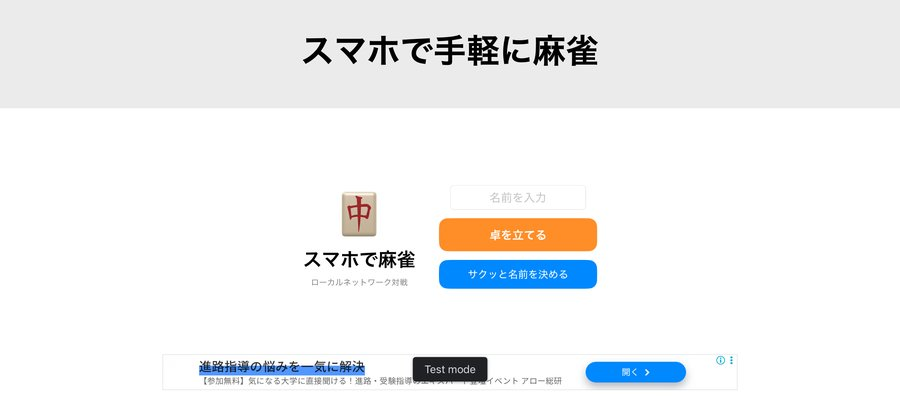
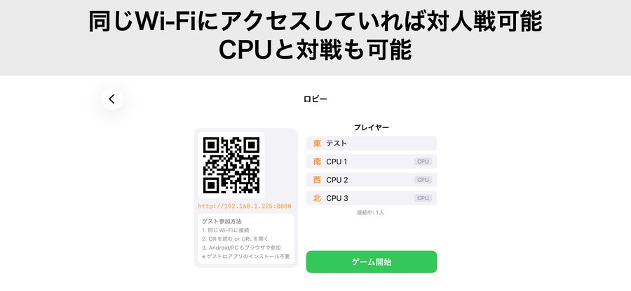
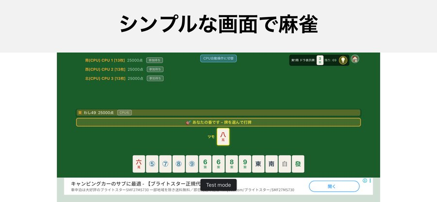

[スマホで麻雀](https://apps.apple.com/jp/app/%E3%82%B9%E3%83%9E%E3%83%9B%E3%81%A7%E9%BA%BB%E9%9B%80-%E3%83%AD%E3%83%BC%E3%82%AB%E3%83%AB%E5%AF%BE%E6%88%A6/id6761806803) は、同じWi-Fiネットワーク内で2〜4台を使ってローカル対戦できる麻雀アプリです。この記事では、作ったきっかけに加えて、1台のiPhoneがどうやって卓になっているのか、遊び方、対応しているルールまでまとめます。

  <figure class="wide"><figcaption>ホスト側のトップ画面</figcaption></figure>

## 目次

- [きっかけ](#motivation)
- [ホスト・クライアント構成にした理由](#host-client)
- [iPhoneが卓になるしくみ](#architecture)
- [遊び方](#how-to-play)
- [対応しているルール](#rules)
- [ヒントとCPU](#hint-cpu)
- [中断と再開](#save)
- [手軽さを優先した](#local-only)
- [制限と注意点](#limits)
- [これまでの更新](#history)

## きっかけ {#motivation}

家族や親戚で集まったときに麻雀をするイメージから生まれたアプリです。もちろん、牌や卓があれば物理的な麻雀が一番楽しいとは思っています。ただ、機材がない場面での暇つぶしや、気軽に卓を囲みたいときに使えるものがあれば、という発想です。

## ホスト・クライアント構成にした理由 {#host-client}

このアプリのこだわりは、**iOSアプリをダウンロードするのは1人だけでよい**という設計です。

  <figure class="wide"><figcaption>同じWi-Fiにいる人はQRコードを読むだけで参加できる</figcaption></figure>

iOSに限定すると、Androidユーザーが参加できません。かといって全員がアプリをインストールするのは手間です。そこでホスト・クライアント構成を採用し、ホスト役の1人だけがiOSアプリを使い、残りのメンバーはAndroidやPCのブラウザから参加できるようにしました。

エンジニアとして普段の仕事でサーバー・クライアント構成を扱ってきた経験が、ここで活きました。

## iPhoneが卓になるしくみ {#architecture}

ホストが「卓を立てる」を押すと、アプリの中で小さなWebサーバーが動き始めます。外部のサーバーは使っていません。

| 役割 | 中身 |
|---|---|
| サーバー | ホストのiPhone。AppleのNetworkフレームワークで待ち受けます |
| 対局画面 | アプリに同梱したHTML・CSS・JavaScript。サーバーがそのまま配信します |
| ゲストの端末 | ブラウザでホストのアドレスを開くだけです |
| 対局の進行 | 山・手牌・点数はすべてホスト側で管理します |

ロビー画面には、ホストのWi-Fi上のアドレスと、それをQRコードにしたものが表示されます。ゲストがそれを開くと、ブラウザは0.5秒おきにホストへ「いまの状況」を問い合わせ、牌を切る・鳴くといった操作はその都度ホストへ送ります。各ゲストに返すのは、その席から見える情報だけです。

実は、ホスト自身の対局画面も同じWebページです。アプリ内のWebビューで、自分の中のサーバーを開いています。ホストとゲストで別々の画面を作らずに済み、見た目や操作の差も出ません。当初はSwiftUIで組んだ対局画面もありましたが、現在は使っていません。

対局のルール部分（牌山、和了判定、役、点数計算）は画面と切り離して書いてあり、Mac上で単体で動かせます。CPU同士で四人・三人・三人（北抜き）の対局を最後まで回し、牌の枚数や点数の合計が合っているか、進行が止まらないかを確かめる検証用のプログラムを用意していて、ルールを触ったら実行するようにしています。

## 遊び方 {#how-to-play}

1. 全員が同じWi-Fiにつなぎます。
2. ホストがアプリを開き、名前を入れます。「サクッと名前を決める」で動物の名前を自動で付けることもできます。
3. 四人麻雀か三人麻雀かを選びます。三人麻雀では「北抜き（抜きドラ）」のON/OFFも選べます。
4. 「卓を立てる」を押すとロビーが開きます。ホスト以外の席は、最初はCPUで埋まっています。
5. ゲストはQRコードを読むか、表示されたアドレスをブラウザで開き、名前を入れて「参加する」を押します。CPUの席が1つ、その人に置き換わります。
6. 人数がそろったら、ホストが「ゲーム開始」を押します。空いた席はCPUが打ちます。

通信が切れたり、ブラウザを閉じてしまったりしても、同じ名前で入り直せば元の席に戻れます。対局中に席を外したいときは、自分の番をCPUに任せる切り替えボタンがあります。ホストは、ほかの席をCPUに切り替えることもできます。

## 対応しているルール {#rules}

| 項目 | 四人麻雀 | 三人麻雀 |
|---|---|---|
| 持ち点 | 25,000点 | 35,000点 |
| 使う牌 | 136枚 | 萬子の2〜8を除いた108枚 |
| チー | あり | なし |
| ツモ和了の支払い | 通常どおり | ツモ損あり |
| 北 | 通常の風牌 | 誰の風でもなく役牌になりません。北抜きONなら1枚につきドラ1 |

対局は東場と南場の半荘で、持ち点がマイナスになった人が出るとそこで終了します。親が和了するか、流局時に親がテンパイしていれば連荘です。

北抜きでは、自分の番に北を抜くと山の末尾から1枚補充します。抜いた北に対するロンはありません。

役は、リーチ、一発、門前清自摸和、タンヤオ、ピンフ、一盃口、役牌（三元牌・場風・自風）、七対子、対々和、三暗刻、混老頭、混一色、清一色、役満の国士無双と四暗刻を判定します。

審査に提出済みのバージョン1.3.1（2026年11月時点で公開前）では、点数まわりを実際の麻雀に近づけます。本場はツモなら各自100点、ロンなら100点×（人数−1）を加算します。流局時のノーテン罰符は場に1,000点×（人数−1）で、ノーテンの人が払い、テンパイの人で分け合います。符は基本20符に、門前ロンで10符、ツモで2符を加え、ピンフのツモは20符として計算します。

## ヒントとCPU {#hint-cpu}

対局画面の電球のボタンを押すと、いまの手牌についての助言が出ます。場に見えている捨て牌・鳴いた牌・ドラ表示牌を数えたうえで、テンパイなら待ち牌と残り枚数を、そうでなければテンパイまでの遠さ、狙えそうな役、切る牌の候補を表示します。役には説明と例も付けているので、役を覚えている途中の人が混ざっていても卓が止まりにくくなります。

CPUは単純な打ち方です。ツモ和了とロンは必ず宣言し、テンパイしてリーチできるならリーチします。捨てる牌は、テンパイに近づくものを選び、同じなら字牌や端の牌から切ります。ポンやチーはしません。CPUの操作は0.5秒おきに1手ずつ進みます。

## 中断と再開 {#save}

局が終わるたびに、対局の状況を自動で端末に保存しています。保存するのは各席の名前・点数・CPUかどうか、場風、親、本場、供託のリーチ棒で、手牌や山は含みません。次に開いたときはホーム画面に「前回の続きから」が出て、次の局から再開できます。半荘が終わると保存データは消えます。

## 手軽さを優先した {#local-only}

麻雀アプリはネット対戦ができるものが多くありますが、このアプリはあえてローカル対戦に特化しています。インターネット接続が不安定な場所でも使えますし、顔を合わせた場での対戦を想定しているので、ネット越しの対戦機能は必要ないと判断しました。

  <figure class="wide"><figcaption>対局画面。横向きでシンプルに</figcaption></figure>

対局の内容がインターネットへ送られることはなく、アカウント登録もありません。初回は、同じWi-Fiの端末とやり取りするために、iOSからローカルネットワークの利用許可を求められます。

対局画面は横長を前提に作っています。バージョン1.3からは縦向きでも開けるようにし、縦のときはページ側で卓を90度回して表示します。ホームとロビーは、画面の幅に応じて左右2列と上下1列を切り替えます。

## 制限と注意点 {#limits}

- ホストとゲストは同じWi-Fiにつながっている必要があります。離れた場所どうしでは遊べません。
- ホストのiPhoneが卓そのものなので、ホストがアプリを終了すると全員の対局が止まります。
- 判定する役は上に挙げたものだけです。三色同順や一気通貫などは判定しません。
- CPUは鳴かず、守りも考えません。人数合わせの相手と考えてください。

## これまでの更新 {#history}

| バージョン | 開発時期 | 主な内容 |
|---|---|---|
| 1.0 | 2026年4月 | ローカル対戦、ブラウザ参加、ヒント、効果音、局ごとの保存と再開 |
| 1.1 | 2026年4月 | ホストが退出したときに警告が繰り返し出る不具合と、参加画面のちらつきを修正 |
| 1.2 | 2026年5月 | 広告の位置を画面下に変更、ノッチや角丸を避けるレイアウト、対局者情報の配置見直し |
| 1.3 | 2026年11月 | 三人麻雀と北抜き、縦向き対応、子のツモ和了の支払い・カン・王牌まわりの不具合修正 |
| 1.3.1（審査中） | 2026年11月提出 | 本場、ノーテン罰符、符計算の修正、再開時に終わった局をやり直さないよう修正 |

麻雀牌を持ち歩かなくても、スマホがあれば場所を選ばず遊べます。ぜひ仲間と試してみてください。

[App Storeで見る](https://apps.apple.com/jp/app/%E3%82%B9%E3%83%9E%E3%83%9B%E3%81%A7%E9%BA%BB%E9%9B%80-%E3%83%AD%E3%83%BC%E3%82%AB%E3%83%AB%E5%AF%BE%E6%88%A6/id6761806803)
