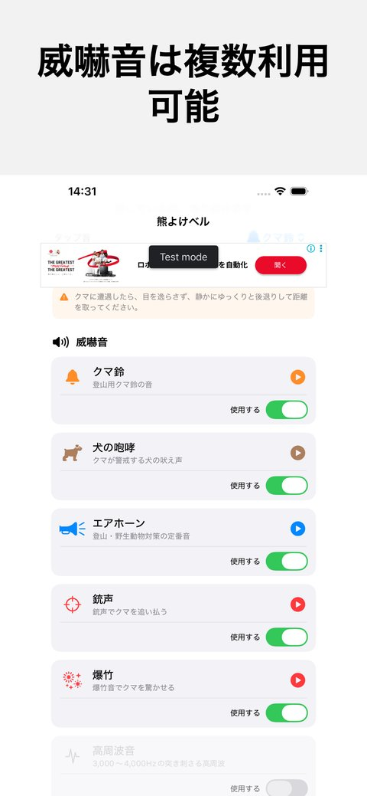
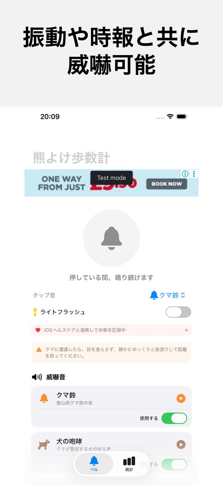
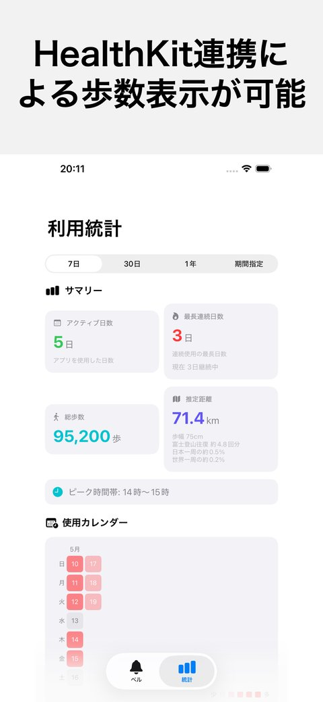

[熊よけベル](https://apps.apple.com/app/%E7%86%8A%E3%82%88%E3%81%91%E3%83%99%E3%83%AB/id6767989638) は、登山やハイキング中の熊対策を目的としたiOSアプリです。この記事では、作ったきっかけに加えて、歩く振動で鈴を鳴らすしくみ、画面を消しても鳴り続ける理由、電池を持たせる工夫までまとめます。

## 目次

- [きっかけ](#motivation)
- [鈴だけでは足りないかもしれない](#sounds)
- [歩行の振動を検知して自動で鳴らす](#shake)
- [時報で定期的に音を出す](#time-signal)
- [画面を消しても鳴り続けるしくみ](#background)
- [電池を持たせる工夫](#battery)
- [万歩計機能も搭載](#pedometer)
- [使い方の例](#how-to-use)
- [データの扱いと注意点](#privacy)
- [これまでの更新](#history)

## きっかけ {#motivation}

野鳥観察や登山を趣味にしているなかで、熊よけの鈴を忘れてしまったときのことを考えて作りました。物理的な鈴がなくても、スマホがあれば代わりになるものを、という発想です。

## 鈴だけでは足りないかもしれない {#sounds}

熊よけとしては鈴が定番ですが、鈴の音だけで確実に熊が警戒するとは限りません。そのため、**ホーンなどの威嚇音**も用意しました。万が一のときに使える音を複数持たせることで、より実用的な安全対策ツールを目指しています。

  <figure><figcaption>鈴のほかにホーンや銃声などの威嚇音を用意</figcaption></figure>

用意している音は次の6種類です。

| 音 | 中身 | 初期状態 |
|---|---|---|
| クマ鈴 | 登山用の熊鈴の音 | 使用する |
| 犬の咆哮 | 犬の吠え声 | 使用する |
| エアホーン | 野生動物対策で使われるホーンの音 | 使用する |
| 銃声 | 銃声の効果音 | 使用する |
| 爆竹 | 爆竹の効果音 | 使用する |
| 高周波音 | 3,000〜4,000Hzを行き来する音。録音ではなくアプリ内で合成しています | 使用しない |

音ごとに「使用する」を切り替えられ、OFFにした音は選択肢から外れます。最初の版では音を合成して作っていましたが、開発の途中でフリーの効果音素材に差し替えました。警告音も、開発の途中でエアホーンに入れ替えています。

ベル画面のいちばん上にあるベルのボタンは、押している間だけ選んだ音を繰り返し鳴らします。「ライトフラッシュ」をONにすると、押している間、端末のライトが0.5秒間隔で点滅します。同じカードの中に、熊に遭遇したときの基本的な対応（目を逸らさず、静かにゆっくり後退りして距離を取る）を一言添えています。

## 歩行の振動を検知して自動で鳴らす {#shake}

歩きながらいちいちスマホを操作するのは現実的ではないため、歩行の振動を検知して自動で鈴を鳴らす機能を搭載しました。ポケットやザックに入れておくだけで動作します。

  <figure><figcaption>歩行の振動や時報に合わせて自動で鳴らす</figcaption></figure>

しくみは単純です。加速度センサーの値を0.1秒おきに読み、3軸を合成した大きさから重力の1Gを引きます。その差がしきい値を超えたら「揺れた」と判定して音を鳴らします。鳴りっぱなしにならないよう、一度鳴らしたら0.5秒は次を鳴らしません。

しきい値は0.10〜1.50Gの範囲を0.05G刻みで調整でき、既定は0.30Gです。画面には数値とあわせて目安を表示しています。

| しきい値 | 表示 |
|---|---|
| 0.25G未満 | 最高（微細な振動） |
| 0.25〜0.5G | 高（通常歩行） |
| 0.5〜0.9G | 中（早歩き） |
| 0.9G以上 | 低（強い振動のみ） |

スマホを入れる場所によって揺れ方は変わります。歩いても鳴らないときは感度を上げ、止まっていても鳴るときは下げてください。自動で鳴らす音は鈴以外にも変えられます。

## 時報で定期的に音を出す {#time-signal}

歩いていない間も音を出したい場面のために、時報の機能があります。設定した間隔ごとに、まず現在時刻を日本語の音声で読み上げ、続けて威嚇音を鳴らします。

- 間隔は1分・3分・5分・10分・15分・30分・60分から選べます。鳴るのは「毎時0分、10分、20分…」のように区切りのよい時刻です。
- 鳴らす時間帯を指定できます。既定は6時から18時です。
- 鳴らす音は1つに決めるか、使用中の音からランダムに選ばせることができます。
- 読み上げの速さを調整できます。

時刻を読み上げるので、休憩中や作業中に時計を見なくても時間の経過がわかります。

## 画面を消しても鳴り続けるしくみ {#background}

iOSのアプリは、画面を消すとまもなく動作を止められます。それでは熊鈴の役目を果たせないので、振動検知か時報がONの間だけ、音量ゼロの音をアプリの中で流し続け、オーディオ再生中のアプリとして動き続けるようにしています。

この無音の再生は、振動検知と時報の両方から使われます。どちらかがONなら続け、両方がOFFになったら止める、という数え方で管理しています。必要のないときまで動かし続けて電池を減らさないためです。

音の再生は、ほかのアプリの音と重ねて鳴らす設定にしています。音楽や地図アプリの音声案内を止めずに、鈴の音を足せます。

## 電池を持たせる工夫 {#battery}

山では電池切れがそのまま危険につながるので、電池まわりの機能を3つ入れました。

**省電力モード**。ポケットに入れる前にタップします。近接センサーを有効にし、端末が布などに覆われると画面の明るさをゼロに、離すと元の明るさに戻します。あわせて加速度センサーを読む間隔を0.1秒から0.2秒に広げます。アプリを閉じて裏に回したときも同じ間隔に切り替わります。

**残り時間の目安**。電池残量と、あとどのくらい使えそうかを表示します。直近最大20分の残量の減り方から計算し、実際より短めに出るよう0.75倍しています。まだ減り方を測れていないうちは、「目安」と付けて概算を出します。

**バッテリー自動停止**。指定した残量以下になったら、振動検知と時報を自動で止めてお知らせします。残量は1〜90%で指定でき、既定は20%です。充電中は止まりません。連絡用の電池を残しておくための機能です。

## 万歩計機能も搭載 {#pedometer}

登山中のお供として使えるよう、万歩計（歩数計）の情報を確認できる機能もついでに付けました。山登りの距離感を把握したり、ちょっとした記録をつけたりするのに使えます。

  <figure><figcaption>HealthKit連携の歩数と距離</figcaption></figure>

歩数と距離は、iPhoneが標準で数えている値を読み出しています。アプリが自前でセンサーを回して数えるわけではないので、歩数計のための電池の負担はほぼありません。iOSのヘルスケアと連携すると、日ごとや時間帯ごとの歩数も表示できます。

「統計」タブでは次の内容を見られます。

- アクティブ日数、歩行時間、総歩数
- 自分の歩幅を設定して求める推定距離
- 日ごとの量を色の濃さで表すカレンダー
- 時間帯ごとのグラフと、いちばん多い時間帯
- 連続して使った最長の日数

集計の期間は7日・30日・1年・期間指定から選べます。この歩数計の機能を足したのに合わせて、アプリ内の画面タイトルは「熊よけ歩数計」になっています。

## 使い方の例 {#how-to-use}

1. 出発前に「設定」の音量を上げ、ベルのボタンを押して音の大きさを確かめます。
2. 「自動クマ鈴」の「振動で鈴を鳴らす」をONにし、その場で少し歩いて感度を合わせます。
3. 必要なら「時報」をONにして、間隔と時間帯を決めます。
4. 「バッテリー自動停止」をONにして、残しておきたい残量を決めます。
5. 「省電力モード」をタップしてから、ポケットやザックに入れます。

## データの扱いと注意点 {#privacy}

- 使用回数や歩行の記録は端末の中だけに保存します。アカウント登録はありません。
- ヘルスケアからは歩数とエクササイズ時間を読み取るだけで、書き込みはしません。
- カメラの権限はライトを点滅させるために使い、撮影はしません。
- 広告は、利用者ごとの最適化をしない設定で表示しています。
- 音の大きさは端末の音量とスピーカーに左右されます。専用の熊鈴や熊スプレーの代わりになるものではなく、忘れたときの備えや補助として使ってください。

## これまでの更新 {#history}

| バージョン | 開発時期 | 主な内容 |
|---|---|---|
| 1.0 | 2026年5月 | 鈴と威嚇音、振動検知、時報と時刻の読み上げ、ライトフラッシュ、省電力モード、電池の監視 |
| 1.1.0 | 2026年5月 | 歩数計、使用統計とカレンダー、ヘルスケア連携 |
| 1.1.1 | 2026年6月 | 強制終了したときに音声の利用が解放されない不具合と、オフライン起動時に画面が白くなる不具合を修正 |
| 1.1.2 | 2026年7月 | オフライン起動時のレイアウト崩れを修正 |

熊よけ対策＋歩数計として、山歩きの相棒になれるアプリを目指しました。

山に出かける機会がある方は、ぜひお供に試してみてください。

[App Storeで見る](https://apps.apple.com/app/%E7%86%8A%E3%82%88%E3%81%91%E3%83%99%E3%83%AB/id6767989638)
