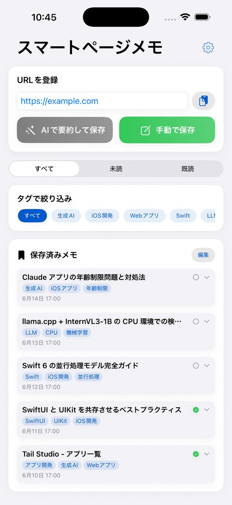
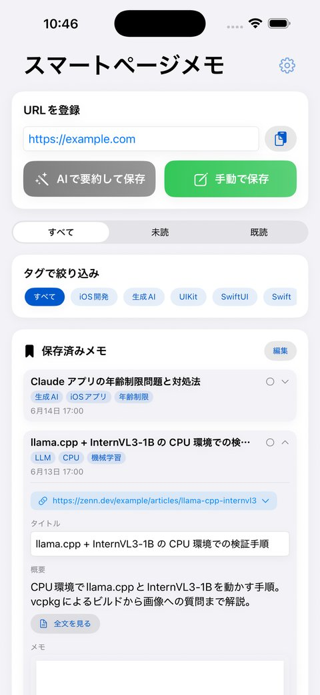
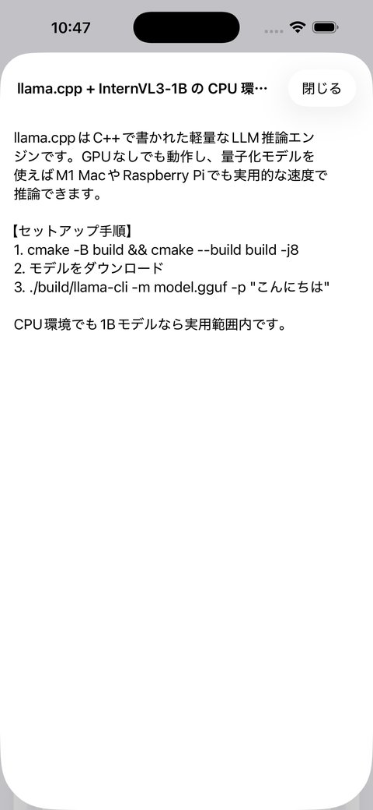

[スマートページメモ](https://apps.apple.com/app/%E3%82%B9%E3%83%9E%E3%83%BC%E3%83%88%E3%83%9A%E3%83%BC%E3%82%B8%E3%83%A1%E3%83%A2/id6777717545) は、URLを入力するだけでAIがタイトル・概要・タグを自動生成してメモに保存するiOSアプリです。この記事では、作ったきっかけとこだわりに加えて、URLを受け取ってから保存するまでの内部の流れ、AIが使えない端末での動き、保存したメモの整理のしかた、データの扱いをまとめます。

  <figure><figcaption>URLを入れるとタイトル・概要・タグ付きで一覧に並ぶ</figcaption></figure>

## 目次

- [きっかけ](#きっかけ)
- [手間を極力なくす](#手間を極力なくす)
- [URLが保存されるまでの流れ](#urlが保存されるまでの流れ)
- [共有ボタンからアプリに渡るしくみ](#共有ボタンからアプリに渡るしくみ)
- [AIはすべてオンデバイスで動作](#aiはすべてオンデバイスで動作)
- [AIが使えない端末での動き](#aiが使えない端末での動き)
- [オフラインで読めることへのこだわり](#オフラインで読めることへのこだわり)
- [保存したメモの整理](#保存したメモの整理)
- [データの扱いと制限](#データの扱いと制限)

## きっかけ

気になる記事やページを後で読もうと思って保存しても、いざ読もうとしたときに何の記事だったか思い出せないことがよくありました。AIに要約してもらえれば、保存した内容を一覧で把握できると思い、作ることにしました。

## 手間を極力なくす

要約アプリとして重視したのは、**操作の手間をとにかく少なくすること**です。

  <figure><figcaption>生成されたタイトルやメモはあとから編集できる</figcaption></figure>

SafariなどブラウザのShare Extension（共有ボタン）から直接このアプリに送れるようにしたため、わざわざアプリを開いてURLをコピー＆ペーストする必要がありません。気になったページをその場でワンタップで保存できます。

URLを登録する方法は、次の3通りです。

| 方法 | 操作 | 向いている場面 |
|---|---|---|
| 共有ボタン | ブラウザの共有シートで「スマートページメモ」を選ぶ | 読んでいるページをその場で保存したい |
| クリップボード | URLをコピーしてからアプリを開く | メールやSNSで受け取ったURLを保存したい |
| 手入力・貼り付け | 入力欄に入力するか、貼り付けボタンを押す | URLがすでに手元にある |

クリップボードからの自動入力は、入力欄が空で、コピーされている文字が `http://` か `https://` で始まるときにだけ働きます。URL以外の文字をコピーしていても、勝手に入力欄へ入ることはありません。

入力欄の下には「AIで要約して保存」と「手動で保存」の2つのボタンがあります。手動で保存を選ぶと、ページの取得やAIの処理を行わず、サイトのホスト名をタイトルにしてすぐ保存します。タイトルやメモはあとから自分で書き足せます。

## URLが保存されるまでの流れ

「AIで要約して保存」を押してから一覧に並ぶまでに、アプリの中では次の処理が順番に動いています。

1. **ページの取得**: URLのHTMLを読み込みます。文字コードは UTF-8 として読み、読めなければ Shift_JIS で読み直します。
2. **本文の取り出し**: HTMLから、ヘッダー・ナビゲーション・フッターの部分と、スクリプト・スタイルを取り除き、残ったタグを外して文章だけにします。改行タグや段落の終わりは改行として残します。
3. **AIへの依頼**: 取り出した文章の先頭2,000文字とURLをAIに渡し、タイトル・概要・タグを決まった形式（JSON）で返すよう指示します。
4. **結果の読み取り**: 返ってきた内容を読み取り、メモとして保存します。取り出した文章の全体も、オフラインで読むために一緒に保存します。

AIへの指示では、次のように条件を決めています。

| 項目 | 指示している内容 |
|---|---|
| タイトル | 30文字以内 |
| 概要 | 2〜4文の日本語。何のサイトか、主な内容を含める |
| タグ | カテゴリを表す日本語のタグを最大5個 |

AIに渡すのは先頭の2,000文字までです。そのため長い記事では、冒頭の内容をもとに概要が作られます。記事の後半にしか出てこない話題は概要に入らないことがあるので、気になる点はメモ欄に書き足しておくと後で探しやすくなります。

## 共有ボタンからアプリに渡るしくみ

共有ボタンから呼ばれる部分（Share Extension）と、アプリ本体は別のプログラムとして動きます。そのため、次の手順でURLを受け渡しています。

1. 共有シートで選ばれると、Share Extension が共有された内容からURLを取り出します。URLそのものが渡されない場合は、`http://` か `https://` で始まるテキストをURLとして扱います。
2. 取り出したURLを、アプリ本体と共有している保存領域（App Group）に書き込みます。
3. アプリ専用のURLスキームでアプリ本体を前面に呼び出します。
4. アプリ本体はURLを受け取ると、入力欄に入れたうえで、そのままAIによる要約と保存を始めます。

URLスキームで受け取れなかった場合に備えて、アプリが前面に来たときに共有領域に残っているURLがないかも確認しています。共有シートに表示されるのは、Webページ（URL）を共有したときだけです。

## AIはすべてオンデバイスで動作

要約に使うAIはAppleのFoundation Models（デバイス上で動作する生成AIフレームワーク）を採用しています。データが外部サーバーに送信されないため、プライバシーの面でも安心して使えます。

要約のために外部のAIサービスへページの内容や閲覧したURLを送ることはありません。アプリが行う通信は、保存するページそのものを取得するための読み込みと、広告の表示に関するものです。

## AIが使えない端末での動き

アプリ自体は iOS 17 以降で動きますが、Foundation Models によるAI要約には iOS 26 以降の対応端末が必要です。AIが使えない場合や、AIの返答をうまく読み取れなかった場合でも保存できるよう、代わりの動きを用意しています。

| 項目 | AIが使えるとき | AIが使えないとき |
|---|---|---|
| タイトル | AIが30文字以内で作成 | サイトのホスト名 |
| 概要 | AIが2〜4文で要約 | 本文の最初の数行（最大100文字） |
| タグ | 最大5個 | なし |
| 全文の保存 | あり | あり |

どちらの場合も、タイトル・メモはあとから編集できます。

## オフラインで読めることへのこだわり

要約だけでなく、ページの内容をオフラインで読めることも意識しました。地下鉄・飛行機・船など、ネットが使えない状況で記事を読みたい場面は意外と多いです。あらかじめ保存しておけば、オフライン環境でも内容を確認できます。

  <figure><figcaption>保存したページの本文はオフラインでも読める</figcaption></figure>

全文の保存は、バージョン 1.1.0 で追加した機能です。メモを開いて「全文を見る」を押すと、保存時に取り出した文章を表示します。

- 保存されるのは文章だけです。画像やページのレイアウトは保存しません。
- 「手動で保存」したメモと、1.1.0 より前に保存したメモには全文がないため、「全文を見る」は表示されません。
- 1.1.0 への更新では、それまでのメモを残したまま保存形式を新しくする処理（SwiftData のマイグレーション）を入れています。

## 保存したメモの整理

メモは新しい順に並び、一覧にはタイトル・タグ（先頭3個まで）・保存日時・既読のマークが表示されます。行をタップすると詳細が開きます。

- **既読と未読**: 一覧の上の切り替えで「すべて／未読／既読」を絞り込めます。詳細の「既読にする」「未読に戻す」で切り替えます。
- **タグで絞り込み**: 保存したメモに付いているタグが、使われている数の多い順に並びます。タップするとそのタグのメモだけが表示されます。既読・未読の絞り込みと組み合わせられます。
- **メモ欄**: 各ページに自由に書き込めるメモ欄があります。AIが作ったタイトルも書き直せます。
- **URLの操作**: ブラウザで開く、URLをコピー、ほかのアプリへ共有、の3つを用意しています。
- **まとめて削除**: 「編集」を押すと複数のメモを選べるようになり、「全選択」と「削除」でまとめて消せます。

設定画面では、文字の大きさを「小・標準・大・特大」の4段階から選べます。すべてのメモを消す「初期化」もここにあります（取り消せないため、確認の画面を挟みます）。

## データの扱いと制限

- 保存したメモ（タイトル・URL・概要・メモ・タグ・全文）は、端末内に保存します。
- AIの処理は端末内で完結します。
- 画面上部に広告（Google AdMob）を表示しており、初回に広告のためのトラッキング許可を確認する画面が出ます。許可しなくてもアプリは通常どおり使えます。
- ページの取得はHTMLを読み込む方式のため、ログインが必要なページや、表示後にJavaScriptで本文を組み立てるページでは、本文をうまく取り出せないことがあります。その場合は概要が短くなったり、全文が空になったりします。

「後で読もう」が確実に手元に残るアプリとして、ぜひ使ってみてください。

[App Storeで見る](https://apps.apple.com/app/%E3%82%B9%E3%83%9E%E3%83%BC%E3%83%88%E3%83%9A%E3%83%BC%E3%82%B8%E3%83%A1%E3%83%A2/id6777717545)
