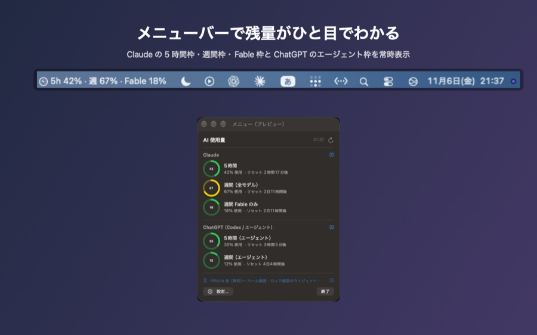
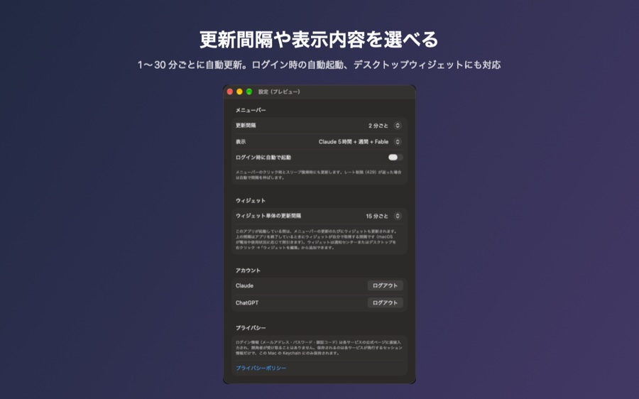

[AI使用量メーター](https://apps.apple.com/app/id6824224890) は、Claude の 5 時間枠・週間枠・Fable 枠と、ChatGPT のエージェント機能（Codex）の枠を、iPhone のアプリとウィジェットで確認する非公式アプリです。公開から 3 週間ほど経って、自分が一番見たいのは Mac で作業しているときだと気づき、Mac 対応を進めました。

Mac App Store 向けの「AI使用量メーター for Mac」は 2026 年 11 月 6 日に審査に提出したところです。審査が通り次第、無料で公開します。

## 目次

- [iPhone アプリを Mac で動かす 2 つの方法](#iphone-アプリを-mac-で動かす-2-つの方法)
- [まず試した iPad 版を Mac で動かす](#まず試した-ipad-版を-mac-で動かす)
- [ネイティブ Mac 版で何を作ったか](#ネイティブ-mac-版で何を作ったか)
- [更新間隔をどう決めたか](#更新間隔をどう決めたか)
- [Mac 版は広告を出せない](#mac-版は広告を出せない)
- [同じアプリに macOS を足すか別アプリにするか](#同じアプリに-macos-を足すか別アプリにするか)
- [ハマったところ](#ハマったところ)

---

## iPhone アプリを Mac で動かす 2 つの方法

Apple Silicon の Mac で iPhone アプリを使う方法は、大きく 2 つあります。

| 方法 | 手間 | 見た目 | 広告 (AdMob) | ウィジェット |
|---|---|---|---|---|
| iPad 版をそのまま Mac で動かす（Designed for iPad） | App Store Connect のチェック 1 つ | iPad のウィンドウ | 出る | **出ない** |
| macOS ネイティブ版を作る | 新しいターゲットを書く | メニューバー・ウィジェットなど Mac らしい形 | 出せない | 出る |

どちらかを選ぶというより、両方に向き不向きがあったので、結果的に両方やりました。

## まず試した iPad 版を Mac で動かす

App Store Connect の「価格および配信状況」に「Apple シリコン搭載の Mac での iPhone および iPad 用のアプリ」という項目があり、「このアプリを配信可能にする」にチェックが入っていれば、iPad 版がそのまま Mac App Store からインストールできます。審査も不要です。私のアプリは最初からオンになっていて、Mac の App Store で検索したらすでに出てきました。

動かしてみると、ログイン（アプリ内の WKWebView）も使用量の取得も問題なく動き、広告バナーも表示されました。ただ 2 つ、期待と違うところがありました。

1 つ目は**ウィジェットが Mac のウィジェットギャラリーに出ない**ことです。iPad 版に入っている WidgetKit の拡張は、この方式では Mac 側に登録されません。macOS 14 以降には「近くにある iPhone のウィジェットを Mac に表示する」機能があるのですが、私の環境（macOS 27）ではシステム設定にその項目が見当たらず、使えませんでした。

2 つ目は、やはり Mac で作業中に見たいのはウィンドウではなく、**メニューバーの数字**だということです。Dock から開いて閉じる操作が挟まると、結局見なくなります。

## ネイティブ Mac 版で何を作ったか

そこで macOS 用のターゲットを別に作りました。API の呼び出し・Keychain・データモデルは iPhone 版の `Shared/` をそのまま共用し、新しく書いたのはメニューバーの UI、ログイン画面の AppKit 側、Mac 用ウィジェットの 3 つです。

  <figure class="wide"><figcaption>メニューバーに「5h 42% · 週 67% · Fable 18%」。クリックで全部の枠が出る（画像はサンプルデータ）</figcaption></figure>

- メニューバーに「5h 5% · 週 43% · Fable 51%」のように常時表示。何を出すか（5 時間だけ、週間も、ChatGPT も、アイコンだけ）は設定で選べます
- クリックすると Claude と ChatGPT のすべての枠をリングで表示。リセットまでの残り時間も出ます
- Dock には出さず（`LSUIElement`）、ログイン時の自動起動にも対応
- デスクトップと通知センターのウィジェット 4 種類（まとめ・Claude・ChatGPT・カスタム）

SwiftUI の `MenuBarExtra` を `.menuBarExtraStyle(.window)` で使っています。ラベルは `Label { Text } icon: { Image }` に **`.labelStyle(.titleAndIcon)`** を付けないとアイコンしか出ない、というところで最初につまずきました。

  <figure class="wide"><figcaption>設定。更新間隔とメニューバーに出す内容を選べる</figcaption></figure>

## 更新間隔をどう決めたか

iPhone のウィジェットは WidgetKit の予算制で、最短 15 分、1 日 40〜70 回程度しか更新されません。Mac のメニューバー常駐アプリにはその制限が無いので、**既定 2 分**（1〜30 分で変更可）のタイマーで取得しています。加えて、メニューを開いたときとスリープ復帰時にも取り直します。

Mac のウィジェット自体は iOS と同じ予算制ですが、本体アプリが取得するたびに `WidgetCenter.shared.reloadAllTimelines()` を呼ぶので、本体が動いている間はメニューバーと同じ間隔で追従します。本体を終了しているときだけ、ウィジェットが自分で（キャッシュが古ければ）取りに行きます。

使っているのは claude.ai / chatgpt.com の非公開エンドポイントなので、429（レート制限）が返ったら 5 分 → 10 分 → … → 60 分と自動で間隔を伸ばす処理も入れました。今のところ 2 分間隔で 429 を受けたことはありません。

## Mac 版は広告を出せない

iPhone 版は無料・広告付きで、広告収益で開発費をまかなっています。Mac 版も同じにしたかったのですが、**AdMob（Google Mobile Ads SDK）は macOS に対応していません。** SDK に入っている xcframework のスライスは `ios-arm64` と `ios-arm64_x86_64-simulator` だけで、macOS 用も Mac Catalyst 用もありません。Google のフォーラムでも「非モバイルはサポート対象外、ロードマップにもない」と回答されています。

Mac で広告を出しているアプリは、Spotify や Skype のように自社で広告を配信できる大手だけで、個人開発者が使えるネットワークは見つかりませんでした。Mac のメニューバーアプリの定番は「無料＋任意の課金」か「一部無料で買い切り」です。

ここで面白いのが、**iPad 版を Mac で動かす方式なら AdMob の広告はそのまま出る**ことです（iOS のバイナリがそのまま動くため。Google が公式に保証しているわけではありません）。そこで、

- 広告付きで Mac に届けたい人向け: iPad 版（Mac App Store で「AI使用量メーター」）
- メニューバーとウィジェットが欲しい人向け: ネイティブ版「AI使用量メーター for Mac」（無料・広告なし）

と住み分けることにしました。ネイティブ版のパネルには iPhone 版へのリンクを 1 行だけ入れてあります。

## 同じアプリに macOS を足すか別アプリにするか

App Store Connect では、既存の iOS アプリに macOS プラットフォームを追加することもできます。ただしそうすると **Mac App Store ではネイティブ版が優先され、iPad 版は Mac に入れられなくなります。** 上の住み分けができなくなるので、別のアプリレコードにしました。同じ名前は使えないため「AI使用量メーター for Mac」です。

## ハマったところ

**Keychain 共有に Mac 用のプロビジョニングプロファイルが要る。** アプリとウィジェットで Keychain を共有するための `keychain-access-groups` は、macOS では Mac 用のプロファイルが無いと署名できません。iOS 用のワイルドカードプロファイルは Platform が iOS/visionOS だけで使えず、`xcodebuild -allowProvisioningUpdates` もアカウント無しでは通りません。結局、Xcode に Apple ID を登録して一度 Run するのが一番早い解決でした。以後は CLI でもビルドできます。

**macOS では `kSecUseDataProtectionKeychain` が必要。** iOS と同じ Keychain のコードをそのまま Mac で動かすと、アクセスグループ付きでも従来のログインキーチェーンに入ってしまい、ウィジェットから読めません。`#if os(macOS)` でクエリに `kSecUseDataProtectionKeychain = true` を足すと iOS と同じ挙動になります。

**Mac App Store への提出は API でほぼ全部できる。** アプリレコードの作成だけは Web 画面が要りますが、掲載文・カテゴリ・年齢制限・価格・配信地域・審査メモ・スクリーンショット・ビルドの紐づけ・審査提出までは App Store Connect API で通りました。提出直前に `contentRightsDeclaration` が未設定で 409 になったのと、スクリーンショット登録直後は数分「Asset is being processed」で弾かれるので再試行が要る、という 2 点が引っかかりどころでした。

Mac 版が公開されたら、このページにリンクを追記します。
