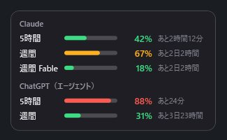
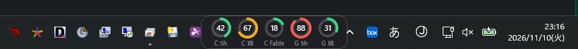

[AI使用量メーター](https://apps.apple.com/app/id6824224890) は、Claude の 5 時間枠・週間枠・Fable 枠と、ChatGPT のエージェント機能（Codex）の枠を確認する非公式アプリで、iPhone と Mac ([Mac 版の記事](/blog/2026/11/06/ai-usage-meter-mac/)) で公開しています。仕事の PC が Windows のこともあり、同じものが欲しくなって Windows 版を作りました。

Microsoft Store には出さず、[Tail-Studio のダウンロードページ](/apps/ai-usage/windows.html)から zip を落として使う形にしています。無料・広告なしです。

## 目次

- [Windows 版で作ったもの](#windows-版で作ったもの)
- [タスクバーに載るリング型ウィジェット](#タスクバーに載るリング型ウィジェット)
- [claude.ai が Cloudflare に弾かれる](#claudeai-が-cloudflare-に弾かれる)
- [ChatGPT のトークンの取り方](#chatgpt-のトークンの取り方)
- [ログイン情報の保存](#ログイン情報の保存)
- [Store を使わず GitHub Release で配る](#store-を使わず-github-release-で配る)
- [ハマったところ](#ハマったところ)

---

## Windows 版で作ったもの

.NET 8 の WPF アプリで、インストール不要の単一 exe（自己完結型、約 60 MB）です。作ったのは次の 3 つです。

| 表示 | 中身 |
|---|---|
| タスクトレイの数字アイコン | 選んだ枠の使用率を数字で表示。60% 未満は緑、85% 未満は橙、それ以上は赤 |
| 詳細ウィジェット | 5 時間・週間・Fable 枠のバーとリセットまでの残り時間 |
| コンパクトウィジェット | リング型のメーターを横に並べた表示。タスクバーに収まる高さ |

トレイに出す値は「Claude 5 時間 / 週間 / 週間 Fable」「ChatGPT 5 時間 / 週間」「最大値」から選べます。更新間隔は既定 2 分で、429 が返ったら 5 分から最大 60 分まで自動で伸ばします。

  <figure><figcaption>詳細ウィジェット。バーと残り時間（画像はサンプルデータ）</figcaption></figure>

## タスクバーに載るリング型ウィジェット

Mac 版のメニューバー表示がちょうどよかったので、同じ発想で「タスクバーの高さに収まるメーター」を作りました。30px のリングの中央に使用率を出し、下に「C 5h」「C 週」「C Fable」「G 5h」のような短いラベルを付けています（C は Claude、G は ChatGPT）。全体の高さは約 46px で、48px のタスクバーにちょうど入ります。

  <figure class="wide"><figcaption>タスクバーの通知領域の左隣に置いたところ（画像はサンプルデータ）</figcaption></figure>

右クリックメニューの「タスクバーの上に置く」を選ぶと、下辺に固定されたタスクバーの通知領域の左隣へ自動で配置されます。ウィンドウは枠なし・背景透過・`Topmost` で、タスクバーの上に重ねているだけです。

ここで困ったのが、**タスクバーを操作すると、Topmost のウィンドウでもタスクバー側が手前に来てウィジェットが隠れる**ことでした。そこで 2 秒ごとに `SetWindowPos(HWND_TOPMOST, … SWP_NOACTIVATE)` を呼び直して、最前面を取り直しています。フォーカスは奪わないので、作業の邪魔にはなりません。

リングは WPF の `ArcSegment` で描いています。使用率から終点の座標を `sin` / `cos` で出し、50% を超えたら `IsLargeArc` を立てるだけです。100% のときは円弧が閉じて消えるので、`Ellipse` に切り替えています。

## claude.ai が Cloudflare に弾かれる

Mac / iPhone 版と同じく、claude.ai の非公開 API を使います。ところが Windows 版を .NET の `HttpClient` で素直に書いたところ、claude.ai だけ 403 になりました。レスポンスヘッダーを見ると `cf-mitigated: challenge`、つまり Cloudflare のボット判定のチャレンジです。ChatGPT 側は通るので、claude.ai 固有の問題です。

回避策として、**画面外に置いた WebView2 で API の URL を開き、`document.body.innerText` の JSON を読む**ことにしました。本物のブラウザエンジンなので、チャレンジは勝手に解けます。

- ログインに使う WebView2 と同じプロファイル（`%APPDATA%\AiUsageMeter\WebView2`）を使うので、Cookie がそのまま効く
- 401 / 403 / 429 は `NavigationCompleted` の `HttpStatusCode` で判定する
- 本文が JSON になるまで最大 16 秒ほど待つ（チャレンジ中は HTML のまま）

HttpClient で取れないサービスに遭遇したら、「ブラウザエンジンに取らせる」が一番手堅い、というのが今回の学びです。

## ChatGPT のトークンの取り方

ChatGPT 側は `https://chatgpt.com/backend-api/wham/usage` を、Bearer トークン付きの HttpClient で叩きます。トークンは WebView2 でログインしたあと、ページ内で次の 2 つを fetch して拾います。

- `/api/auth/session` … `accessToken` と有効期限
- `/backend-api/accounts/check/v4-2023-04-27` … ワークスペース（個人 / チーム）の一覧

結果は `window.__aum` に入れて、アプリ側が数秒おきにポーリングします。期限が 24 時間を切ったとき、または 401 が返ったときは、画面外の WebView2 でこのスクリプトをもう一度走らせて、ログインし直しなしでトークンを更新します。

## ログイン情報の保存

セッションキーとトークンは、Windows の DPAPI（`ProtectedData`、現在のユーザー範囲）で暗号化して `%APPDATA%\AiUsageMeter\settings.json` に保存します。iPhone / Mac 版の Keychain に相当します。別のユーザーや別の PC に設定ファイルをコピーしても復号できません。広告・解析 SDK は入れていませんし、使用量の取得以外の通信もしません。

## Store を使わず GitHub Release で配る

今回は Microsoft Store を使わず、Android アプリと同じ構成にしました。

1. 単一 exe を `dotnet publish -r win-x64 --self-contained -p:PublishSingleFile=true` で作り、README と一緒に zip にする
2. 公開用の別リポジトリ（`ai-usage-meter-releases`）の GitHub Release に `AiUsageMeter-Windows.zip` として載せる
3. Tail-Studio のダウンロードページから `releases/latest/download/AiUsageMeter-Windows.zip` に直リンクする

アセット名を固定しておくと、新しい版を上げても、ページのリンクを書き換えなくて済みます。

コード署名はしていないので、初回起動時に SmartScreen の警告が出ます（「詳細情報」→「実行」）。ダウンロードページにもそう書いています。

## ハマったところ

**Windows 11 ではトレイアイコンが隠れる。** 新しく出したアイコンは `^` の中に入ってしまい、「タスクバーで % が見える」という目的を最初から果たしません。ユーザーがアイコンを `^` からタスクバーへドラッグするか、設定の「その他のシステムトレイ アイコン」を ON にする必要があります。コンパクトウィジェットなら、この手順なしでタスクバー上に常に見えるので、こちらを主役にしてもよいと思っています。

**BOM なしの UTF-8 が別の文字コードとして読まれる。** 日本語を含む `.cs` を BOM なしで保存したところ、Codex のレビューで「文字列リテラルが壊れている」と指摘されました。ツール側が旧来のコードページで読んでいたのが原因で、全ファイルに BOM を付けて解消しました。

**ウィジェットが画面の右端で見切れる。** 初回表示のときは `ActualWidth` が確定していないので、位置の補正を `ContentRendered` のあとと `SizeChanged` で行うようにしました。

---

Windows 10 / 11 で動作します（WebView2 ランタイムが必要で、Windows 11 には最初から入っています）。ダウンロードは [Windows 版のページ](/apps/ai-usage/windows.html) からどうぞ。
