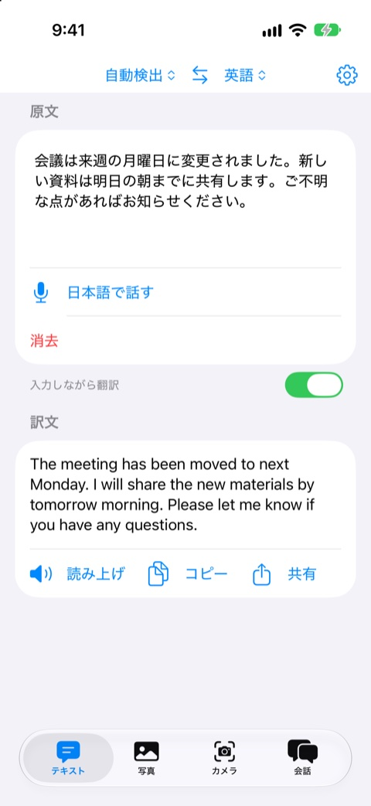
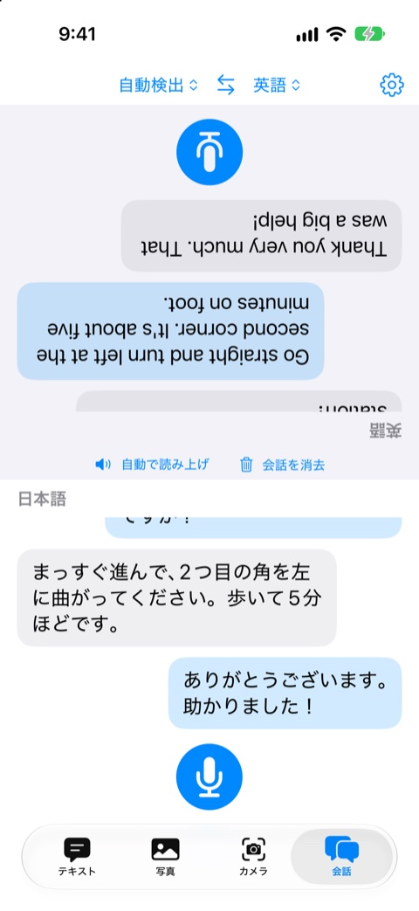

[ローカルAI翻訳](https://apps.apple.com/jp/app/id6833263560) は、翻訳用の AI モデルを iPhone の中に保存して使う翻訳アプリです。最初に一度モデルをダウンロードしたあとは、機内モードでも、通信できない場所でも、文章・写真・カメラ・音声を翻訳できます。入力した内容は端末の外へ送られません。

  <figure><figcaption>テキスト翻訳。入力しながら訳が出る</figcaption></figure>
  <figure><figcaption>写真翻訳。元の位置に訳を重ねる</figcaption></figure>
  <figure><figcaption>会話モード。向かい合って使える</figcaption></figure>

## 目次

- [なぜオンデバイスで翻訳したいのか](#なぜオンデバイスで翻訳したいのか)
- [使っているモデル](#使っているモデル)
- [llama.cpp で動かす](#llamacpp-で動かす)
- [長い文章は文ごとに訳す](#長い文章は文ごとに訳す)
- [写真・カメラ・音声・会話](#写真とカメラと音声と会話)
- [550MBのモデルをどう届けるか](#550mbのモデルをどう届けるか)
- [語彙を削って軽くできないか調べた](#語彙を削って軽くできないか調べた)
- [向いている使い方・向いていない使い方](#向いている使い方向いていない使い方)

## なぜオンデバイスで翻訳したいのか

翻訳アプリの多くは、入力した文章をサーバーに送って訳を受け取ります。旅行先で電波が弱いとき、社内の文書やメールの文面を外に出したくないとき、この仕組みは不便だったり、気になったりします。

端末の中だけで完結すれば、通信の有無に左右されず、送信される内容もありません。小さな翻訳モデルが実用になってきたので、それを iPhone に載せるとどこまで使えるのかを確かめるつもりで作り始めました。

## 使っているモデル

翻訳エンジンには、Preferred Networks が公開している **PLaMo 3 Translate 0.8B** を使っています。パラメータ数 8億の翻訳特化モデルで、アプリには 4bit 量子化（Q4_0）した GGUF 形式を載せています。

| 項目 | 内容 |
|---|---|
| モデル | PLaMo 3 Translate 0.8B（GGUF・Q4_0） |
| ファイルサイズ | 約 547MB |
| 対応言語 | 53 言語 |
| 精度を確認している言語 | 日本語・英語を中心とした 15 言語 |

53 言語を扱えますが、開発元が精度を評価しているのは主要な 15 言語です。それ以外の言語は、精度が下がることがあります。アプリの使い方ページにも、この点は正直に書いています。

モデルの利用は PLaMo コミュニティライセンスに沿っており、アプリ内にも「Built with PLaMo」の表示を入れています。

## llama.cpp で動かす

iPhone で GGUF を動かすために、推論エンジンは **llama.cpp** を使いました。iOS 向けに xcframework をビルドしてアプリに組み込み、Swift から C の API を呼びます。

実装で気をつけたのは次のあたりです。

- **プロンプトは手で組み立てる**。モデルの chat template は jinja で書かれていますが、iOS 側で jinja を扱うのは大げさなので、PFML3 という形式のプロンプトを Swift の文字列として自前で組んでいます。
- **サンプリングは greedy**。翻訳は創作ではないので、毎回同じ入力から同じ訳が出るほうが扱いやすく、温度を持たせない方式にしました。
- **コンテキストは 2048 トークン**。メモリを抑えるため小さめに固定し、長い入力は呼び出し側で分割します。
- **推論は actor の中で実行する**。生成のループ中にキャンセルされたら、すぐ止められるようにしています。

0.8B という小ささのため、大きなクラウドの翻訳と比べれば細かいニュアンスは劣ります。そのかわり、「意味が通じる訳がすぐ手元に出る」ことを優先しました。

## 長い文章は文ごとに訳す

小さなモデルに長い文章を一度に渡すと、訳が抜けたり、途中で崩れたりしやすくなります。そこで、入力を **NLTokenizer で文に分割し、1 文ずつ訳して並べる** 方式にしました。

この方式には、入力しながら翻訳する機能と相性が良いという利点もあります。訳した文はキャッシュしておき、変わっていない文は再計算せず、書き換えた文だけをモデルに通せば済みます。入力を足していっても、毎回全文を訳し直さなくて済みます。設定で「入力しながら翻訳」のオンオフを切り替えられます。

原文を「自動検出」にした場合は、文ごとに言語を判別します。原文がすでに翻訳先と同じ言語だったときは、反対側の言語へ訳すので、会話モードで両方の言語を話しても同じ設定のまま使えます。

## 写真とカメラと音声と会話

テキスト以外の入力は、iOS が標準で持っている仕組みと組み合わせています。

| 機能 | 使っているもの |
|---|---|
| 写真翻訳 | Vision の文字認識で文字と位置を取り、訳文を元の位置に重ねて表示 |
| カメラ翻訳 | DataScanner で文字を検出し、その場で訳文を重ねる |
| 音声入力 | Speech フレームワークの端末内認識 |
| 読み上げ | AVFoundation の音声合成 |
| 会話モード | 画面を上下に分け、相手側を反転表示。それぞれの言語で話すと訳が読み上げられる |

写真翻訳は、メニューの写真を撮って訳す使い方を想定しています。文字認識で取れた行をまとまりにして訳すので、看板やメニューのような短い文字列と相性が良いです。画面が広い端末では、右側に訳文の一覧も出ます。

音声認識は、**iOS が端末内で認識できる言語に限られます**。端末にない言語は、iOS 26 以降なら初回に言語データを自動でダウンロードして使えるようになることがあります。ここはアプリではなく OS の制約なので、使い方ページの FAQ に書きました。

## 550MBのモデルをどう届けるか

いちばん悩んだのは、約 550MB あるモデルの配布方法でした。アプリ本体に同梱すると、ダウンロードサイズが大きくなりすぎます。そのため、初回起動時に別途ダウンロードする方式にしています。

取得元は 2 系統用意しました。

1. **Apple のホスティング（アセットパック）**。App Store Connect にモデルを上げておき、iOS 26 以降で優先して使います。
2. **Hugging Face**。Apple 配信が使えない場合の予備です。ダウンロード後は SHA256 で整合性を検証します。

設定の「モデルの取得元」で「Hugging Face のみ」を選べるようにしてあるので、Apple 配信がうまく動かない環境でも、もう一度試せます。ダウンロードは中断と再開ができ、アプリを閉じても続きます。

アセットパックを使うときの落とし穴が 1 つありました。**ダウンロード用の拡張機能（StoreDownloaderExtension を持つターゲット）が無いと、AssetPackManager が起動時の assertion で落ちます。** エラーメッセージからは原因が分かりにくく、拡張機能と必ずセットで使う必要があると気づくまでに時間がかかりました。

## 語彙を削って軽くできないか調べた

モデルが重いので、日本語と英語だけに絞った小さなモデルを作れないかも調べました。PLaMo のライセンスは派生モデルの作成と配布を認めているので、法的には可能です。

調べた内容は次のとおりです。

- 語彙は 107,520 個あり、英数字が約 54,000、漢字・かなが約 49,000、その他の文字が約 3,000。文字種だけで絞っても、減るのは約 3% でした。
- 日英の例文コーパス（Tatoeba、各 15 万文）で実際に使われる語を数え、2 回以上出てくる語だけ残すと、語彙は約半分になります。
- ただし、モデルのサイズは **約 114MB（約 21%）しか減りません**。ブロック部分の重みが大半を占めるので、語彙をゼロにしても下限があります。
- 削った語が入力に出てくると、バイト単位の分割にフォールバックします。この部分の埋め込みはほとんど学習されていないため、品質が少し下がるのではなく、崩れる危険がありました。

効果が約 2 割にとどまり、リスクとの釣り合いが取れないため、**今回は見送りました。** 標準モデルが重すぎるという声が実際に出てきたら、そのときに再検討するつもりです。公式の Q3_K_M 版（約 490MB）に切り替える案も候補ですが、iPhone での速度を測ってからにします。

## 向いている使い方・向いていない使い方

実際に使ってみて、向き不向きははっきりしています。

**向いているもの**

- 旅行先でのメニュー・看板・案内の翻訳
- 通信が不安定な場所での短い会話
- 外に出したくない文面を、内容を確認する目的で訳す

**向いていないもの**

- 長い契約書や論文を、正確なニュアンスで訳したいとき
- 主要 15 言語以外の言語で、高い精度が必要なとき

小さなモデルなので、固有名詞や言い回しの癖で間違うことがあります。大事な文書は、結果を鵜呑みにせず確認してください。

通信が不要で、内容が外に出ない翻訳アプリが欲しい方は、試してみてください。使い方は [使い方・サポート](/apps/local-ai-translate/guide.html)、情報の扱いは [プライバシーポリシー](/apps/local-ai-translate/privacy-policy.html) に書いています。

[App Storeで見る](https://apps.apple.com/jp/app/id6833263560)
