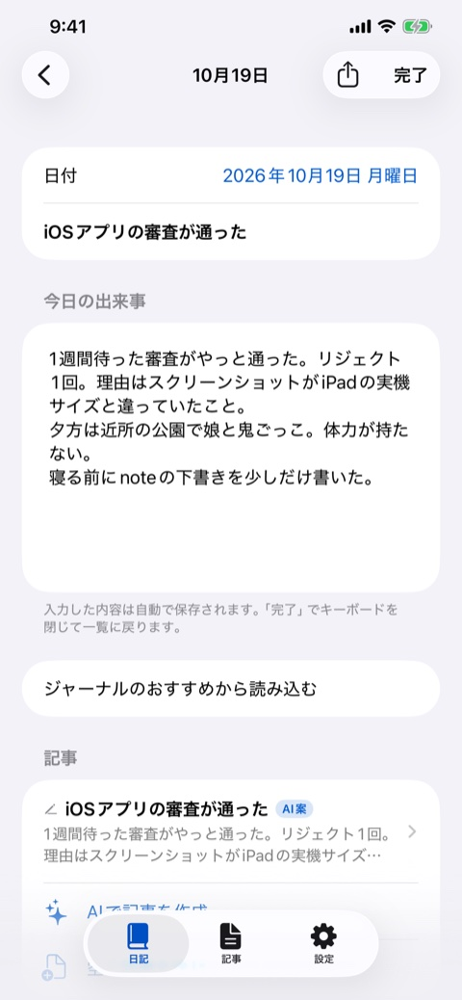
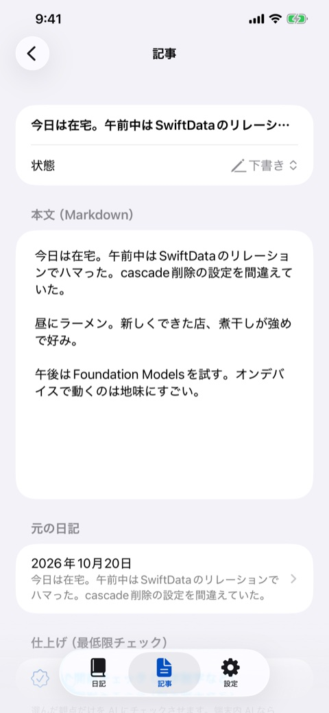
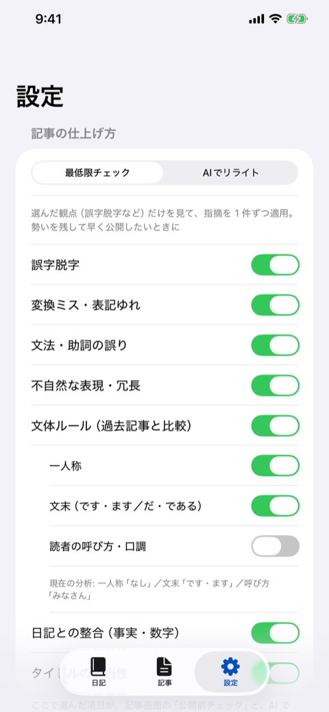

[nikkiji（にっきじ）](https://apps.apple.com/jp/app/id6822274695) は、日記を書くと、あなたが過去に書いた記事の文体を真似たブログ記事の下書きを、オンデバイスの AI が提案してくれる iOS アプリです。日記も、AI の処理も、すべて端末の中で完結します。

  <figure><figcaption>日記を書くと「AI案」が裏で作られる</figcaption></figure>
  <figure><figcaption>記事の画面。元の日記にすぐ戻れる</figcaption></figure>
  <figure><figcaption>仕上げは見たい観点だけ選べる</figcaption></figure>

## 目次

- [日記とブログの間にある面倒を減らしたい](#日記とブログの間にある面倒を減らしたい)
- [文体を真似させるのは意外と難しい](#文体を真似させるのは意外と難しい)
- [長文は一度に生成させない](#長文は一度に生成させない)
- [公開前チェックは「直して書かせて差分を取る」](#公開前チェックは直して書かせて差分を取る)
- [記事案は裏で自動的に作る](#記事案は裏で自動的に作る)
- [ブログの記事を取り込む方法](#ブログの記事を取り込む方法)
- [Apple「ジャーナル」との連携](#apple-ジャーナルとの連携)
- [審査で名前の変更を求められた](#審査で名前の変更を求められた)

## 日記とブログの間にある面倒を減らしたい

日記を書くのは続けやすいのに、ブログ記事にしようとすると途端に腰が重くなる、という人は多いと思います。日記のネタは記事になるのに、書き起こす時間が取れず、下書きだけが溜まっていく。

nikkiji は、日記を書いたあとの面倒な部分を AI に預けるアプリです。日記を書く画面が中心で、記事は日記の「サブページ」として作ります。

| 画面 | できること |
|---|---|
| 日記 | 月ごとの一覧とカレンダー。1 日 1 件、入力と同時に自動保存 |
| 記事 | 下書き・公開済みの一覧。日記に紐づかない単独の記事も作れる |
| 設定 | 文体の分析結果の確認、記事の仕上げ方、バックアップ |

動作には Apple Intelligence に対応した iPhone・iPad（iOS 26 以降）が必要です。AI は Foundation Models の端末内モデルを使うので、通信は発生しません。

## 文体を真似させるのは意外と難しい

このアプリの売りは「自分の文体で書く」ことですが、ここがいちばん難しいところでした。

最初は、過去の記事を AI に読ませて「文体の特徴」を自由文で要約させ、それを生成時の指示に添えていました。ところが、端末内の小さなモデルは、**その要約をほとんど無視します。** 「俺」「だ・である」で書く人の記事が、「です・ます」の丁寧な文章で出てきてしまいました。

効いたのは、次の組み合わせです。

1. **構造化して分析する。** 過去の記事を 1 本ずつ、一人称・文末・読者の呼び方・トーン・書き出しの型・口癖といった項目に分けて読み取らせる。
2. **一人称・文末・呼び方は、モデルに推測させない。** 本文の出現回数や文末のパターンを **コードで数えて**、多数決で決める。
3. **「最優先で必ず守る文体ルール」として指示に明記する。**
4. **過去記事の冒頭を 2 本、お手本として添える。**（コピーは禁止と明記）
5. **生成後にコードで検査する。** 一人称や文末が違っていたら、1 回だけ指摘をつけてやり直す。

モデルの判断に任せるのではなく、数えられるものは数える。これで、一人称と文末はかなり安定して守られるようになりました。Mac 上で同じソースを動かして確認したところ、「俺／だ・である」のサンプル 2 本から、文体が守られた記事が出ています。

設定で一人称や文末を手動で指定することもでき、その場合は分析結果より優先されます。

## 長文は一度に生成させない

もう 1 つの問題は、長い記事を 1 回で生成させると、**同じ文の繰り返しや途中切れが頻発する** ことでした。「だから、」で本文が終わる、同じ文が延々と続く、といった具合です。

対策は、生成を 2 段階に分けることでした。

- **骨子を作る。** タイトル、導入、見出し 3 つ、各見出しの要点、締めを、短い構造化出力で作る。短いので安定する。
- **本文は段落ごとに短く生成する。** 導入・見出しごと・締めの 5 つを、1 つずつ生成して組み立てる。見出しの `##` はコード側で付けるので、必ず入る。

各段落は、繰り返しの検出と、文の途中で終わらせない処理を通します。短すぎれば 1 回やり直します。

記事の長さも、日記の長さに連動させます。2 行の日記から 1500 字の記事が出てきたことがあり、さすがに「盛りすぎ」でした。今は日記が短ければ短い記事、長ければ見出しを増やして長めの記事になります。設定で固定することもできます。

安全ガードレールは、かなり保守的です。病気や事故などの話題に触れただけで生成が拒否されることがあるため、1 件の失敗で全体を止めず、その段落や記事だけを飛ばして続けるようにしてあります。

## 公開前チェックは直して書かせて差分を取る

下書きが溜まる理由の 1 つは、「丁寧に直したい」と思って手が止まることです。そこで、**選んだ観点だけを AI にチェックしてもらい、指摘を 1 件ずつ適用できる**「公開前チェック」を付けました。誤字脱字、変換ミス、文法、不自然な表現、文体ルール、日記との整合、タイトルなどから選べます。

実装でわかったのは、小さなモデルに「誤りを列挙して」と頼むと、**誤字が 3 つある段落でも「なし」と返す** ことでした。そこで方法を逆にしました。

- 段落ごとに「指定した観点の誤りだけ直した段落を出力して。ほかは 1 文字も変えない」と頼む
- 元の文と、文単位で比較して、違う部分を指摘にする

この方式にしたら、1〜2 秒で正確に直るようになりました。文の数が変わったときは段落単位の指摘にし、大きく書き換えられたものは「内容を確認」と表示して、利用者に判断してもらいます。

それでも見逃すものはあります。「とと」のような助詞の重複、「こんにちわ」、句読点の重複といった定番のミスは、**正規表現でコード側に持って、モデルの前に走らせます。** 「もも」「はは」のように正しい語と紛らわしいものは「要確認」の扱いにしました。

一方、個人情報の検出は取りやめました。「下書きが溜まってきた。」のような普通の文を実名と判定するなど、作り話の指摘が多かったためです。誤検出で文が消える事故を避けるため、整合やタイトルのような報告系の指摘は「要確認」の表示のみで、自動では適用しません。

設定の「記事の仕上げ方」には、2 つのモードがあります。

| モード | 動き |
|---|---|
| 最低限チェック | 日記を「すでに書かれた下書き」として扱い、本文は原文のまま。AI はタイトルと見出しの位置を決めるだけで、あとは選んだ観点のチェックのみ |
| AIでリライト | 誤字や読みにくさ、文体を整えて全文を書き直す。「リライト前に戻す」で復元できる |

「勢いを残して早く公開したい」人と、「整えてから出したい」人で、AI にやらせる範囲を変えられます。端末内の AI に満足できないときのために、プロンプトをコピーする機能や、ChatGPT・Claude などのアプリへ共有する機能も用意しました。

## 記事案は裏で自動的に作る

日記を書いて画面を閉じると、裏で記事案を作って、日記の記事欄に「AI案」として入れます。最近 30 日以内に更新された日記が対象で、手で書いた記事や、利用者が編集した自動案には触りません。

処理は、アプリが前面にあるうちに進め、閉じたあとは iOS の `BGProcessingTask` に任せています。実行タイミングは iOS 任せで、夜間に確実に走る保証はありません。1 日記ごとに保存するので、途中で打ち切られても成果は残ります。

自動案は文体分析の材料に入れません。自分の出力を学習してしまうと、文体がだんだんずれていくためです。

## ブログの記事を取り込む方法

文体を学ぶには、過去の記事が必要です。取り込み方は 3 つ用意しています。

1. **サービスの公式エクスポート**（おすすめ）。ブラウザから書き出した ZIP（XML）をアプリで選ぶ。全記事・全文が対象で、規約上いちばん安全
2. **RSS**。最新の記事の冒頭部分だけが取れる簡易的な方法
3. **公開されているページからの取得**。設定でオフにできる

公式エクスポートの読み込みは `XMLParser` で実装しました。note.com は、ユーザー自身に渡すデータとして書き出し機能を提供しているので、それを使うのがいちばん素直です。

アプリは、特定のブログサービスの公式アプリではなく、各サービスの運営会社とは関係のない個人開発のアプリです。

## Apple ジャーナルとの連携

日記アプリである以上、Apple の「ジャーナル」アプリとの連携は外せませんでした。

- **書き出し**: 日記の共有ボタンから、共有先に「ジャーナル」を選ぶ
- **おすすめの読み込み**: ジャーナルが使うのと同じ「おすすめ」（場所、ワークアウト、写真の枚数など）を選んで、日記の末尾にテキストとして追記する
- **エントリの取り込み**: ジャーナルから書き出したファイルを選ぶと、1 エントリを 1 日記として取り込む

Apple はジャーナルの既存エントリを直接読む API を公開していません。そのため、ジャーナルアプリの「書き出す」で出るファイル（iOS 26 では ZIP ではなくフォルダ）を解析する方式にしました。iOS には ZIP を展開する公開 API が無いので、ZIP の読み込みは自前で書いています。

ここでも罠がありました。**端末の暦が和暦だと、`Calendar.current` で日付を組み立てたときに令和 2026 年が西暦 4044 年になります。** 日付を作るときは、必ずグレゴリオ暦を明示します。

## 審査で名前の変更を求められた

このアプリは最初「デイリーノート」という名前で出していました。ところが、App Store の審査で、**他社のブランド名（note）を名前や掲載情報に含んでいる** ことを理由に、ガイドライン 4.1(c) で却下されました。

そこで、アプリ名を **nikkiji（にっきじ）** に変更し、サブタイトル・キーワード・概要・アプリ内のタブ名から、ブランド名を取り除いて出し直しました。Bundle ID やプロジェクトの内部名は変えていません。

他社のサービス名を使うときは、名前や掲載文に入れてはいけない、という典型的な例だと思います。

日記を書く習慣はあるのに、ブログにするところで止まっている方に、試してもらえればうれしいです。情報の扱いは [プライバシーポリシー](/apps/daily-note/privacy-policy.html) にまとめています。

[App Storeで見る](https://apps.apple.com/jp/app/id6822274695)
