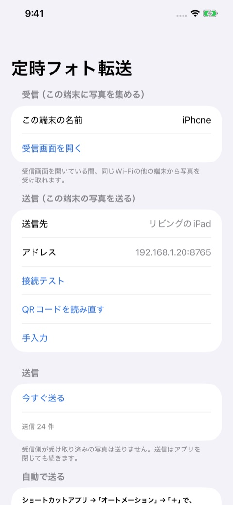
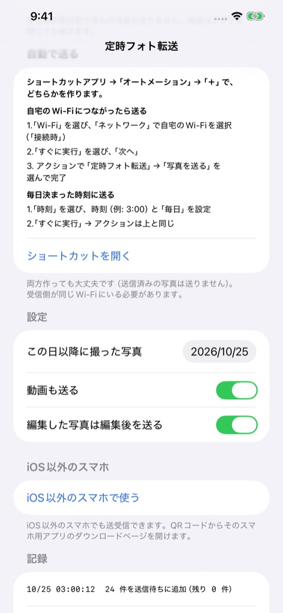
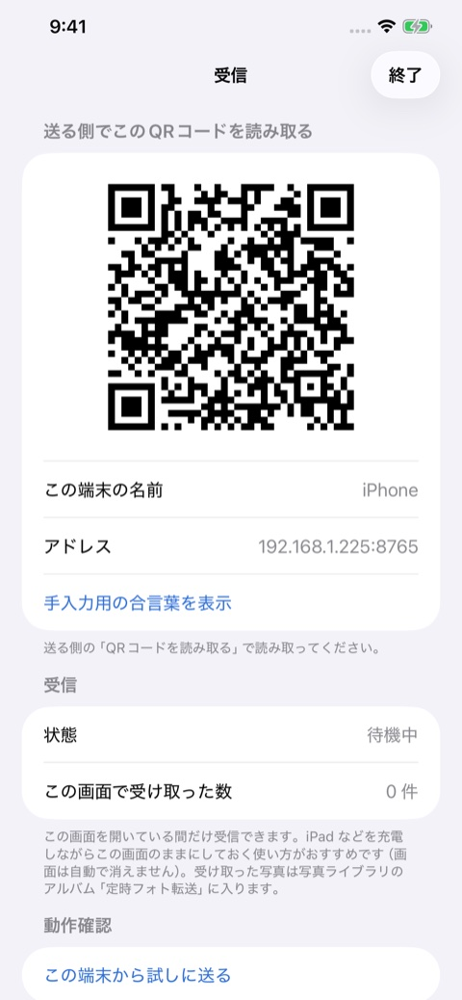

[定時フォト転送](https://apps.apple.com/jp/app/id6826420187) は、スマホで撮った写真を、同じ Wi-Fi にいる別の端末へ **決まった時刻、または自宅の Wi-Fi につないだときに自動で送る** アプリです。送るのは新しく撮った写真だけで、インターネット上のサーバーは通りません。端末どうしで直接やりとりします。

  <figure><figcaption>送信側の画面。送信先を決めておくだけ</figcaption></figure>
  <figure><figcaption>自動で送る設定はショートカットで作る</figcaption></figure>
  <figure><figcaption>受信側は QR コードを見せるだけ</figcaption></figure>

## 目次

- [作ろうと思った理由](#作ろうと思った理由)
- [仕組みの全体像](#仕組みの全体像)
- [iOS は「決まった時刻に動く」のが苦手](#ios-は決まった時刻に動くのが苦手)
- [20秒の制限を分割で乗り切る](#20秒の制限を分割で乗り切る)
- [ペアリングは QR コードと Bonjour](#ペアリングは-qr-コードと-bonjour)
- [二重に送らないための工夫](#二重に送らないための工夫)
- [プライバシーと権限](#プライバシーと権限)
- [審査で気をつけたこと](#審査で気をつけたこと)

## 作ろうと思った理由

写真をほかの端末へ移したい場面は、意外とあります。家族の写真を 1 か所に集めたい、使っていない端末を写真のバックアップ先にしたい、といったものです。

クラウドのサービスを使えば解決しますが、容量や月額の問題があり、そもそも写真を外のサーバーに置きたくない人もいます。一方で、同じ家の Wi-Fi の中なら、端末どうしで直接送るほうが速くて安全です。それを **毎日放っておいても勝手にやってくれる形** にしたのがこのアプリです。

## 仕組みの全体像

役割は「送信側」と「受信側」の 2 つで、同じアプリがどちらにもなれます。

| 役割 | やること |
|---|---|
| 受信側 | 受信画面を開いて待ち受ける。QR コードを表示し、届いた写真をアルバム「定時フォト転送」に保存する |
| 送信側 | 受信側の QR コードを読み取って送信先を登録する。決まった時刻や Wi-Fi 接続時に、まだ送っていない写真を送る |

iPhone・iPad のほか、iOS 以外のスマホ用アプリも用意しています。こちらは送信にも受信にも使えます。受信側にすると、写真を集める端末として常に待ち受けます。

iPhone・iPad を受信側にするときは、**受信画面を開いている間だけ** 受け取れます。iPad などを充電しながら受信画面のままにしておく使い方がおすすめです。常時の待ち受けが必要なら、iOS 以外のスマホを受信側にするのが向いています。

通信の中身は単純な HTTP です。

1. 送信側が、送りたい写真の ID の一覧を `/api/check` に渡し、受信側にまだ無いものを教えてもらう
2. 古い順に、1 枚ずつ `/api/upload` に送る
3. 受信側が「保存した」または「すでに受信済み」と返す

認証には、受信側が作る 24 文字のランダムな合言葉を使います。合言葉が合わない送信は、受信側が受け付けません。

## iOS は決まった時刻に動くのが苦手

このアプリでいちばん手間がかかったのは、**iOS で時刻を指定して裏で処理を動かすこと** でした。

iOS には `BGTaskScheduler` というバックグラウンド処理の仕組みがありますが、これは「いつかのタイミングで実行してもらう」ためのもので、時刻を守る保証がありません。夜中の 3 時に確実に送りたいという用途には使えません。

確実に動かせたのは、**ショートカットアプリの「オートメーション」** でした。

- 「時刻」のオートメーションに、アプリのアクション「写真を送る」を登録する
- 「すぐに実行」を選んでおけば、確認なしで決まった時刻に動く
- アクションはアプリを開かずに動くよう（`openAppWhenRun = false` の App Intent）にしてある

自宅の Wi-Fi につながったときに送りたい場合は、トリガーを「Wi-Fi」にして自宅のネットワークを選びます。

アプリ側からオートメーションを自動で登録することはできないので、設定画面に手順を書き、ショートカットアプリを開くボタンを置きました。ひと手間かかるのはこのアプリの弱点ですが、一度作ってしまえば、あとは放っておけます。予備として、`BGProcessingTask` も登録してあります。

## 20秒の制限を分割で乗り切る

次の壁は、オートメーションから呼ばれるアクションの **実行時間が短い** ことです。数百枚の写真や動画を、その時間内に送りきることはできません。

そこで次のように分割しています。

1. アクションの中では、最大 20 秒・60 件・800MB までを目安に、写真を書き出してバックグラウンドの `URLSession` に積む
2. 積んだあとはアクションを終了する。転送そのものは OS が続けてくれる
3. 転送が終わると、iOS がアプリを裏で起こす（`handleEventsForBackgroundURLSession`）
4. そこで次のまとまりを積む。これを繰り返す

**1 件も成功しなかったまとまりのあとは、連鎖を止める** ようにしました。受信側の電源が切れているときに、延々と再試行を繰り返さないための安全装置です。

もう 1 つの落とし穴は、アプリが前面にあるときは、この「終わった」通知が来ないことでした。前面では `didCompleteWithError` で残りのタスクが 0 になったことを見て、次のまとまりを積んでいます。このとき、actor の中で `await` すると処理が再入するので、実行中の `Task` を保持して二重に動かないようにしました。

写真の取得も、素直には済みません。編集済みの写真は編集後のものを送るか選べるようにし、iCloud 上にしか元データがない写真も取得しています。

## ペアリングは QR コードと Bonjour

送信先の登録は、受信側の画面に出る **QR コードを送信側のカメラで読み取る** だけです。QR コードには、受信側の IP アドレス、ポート、合言葉、端末名が入っています。読み取れない場合のために、手入力用の合言葉も表示できます。

家庭用のルーターは、再起動すると端末の IP アドレスが変わることがあります。登録した IP につながらなくなったら、**Bonjour**（mDNS）で同じ端末名のサービスを探し、見つかった IP に自動で更新します。

Bonjour まわりでハマった点をいくつか書いておきます。

- Info.plist の **`NSBonjourServices` にサービス種別を書かないと、公開も検索も黙って失敗します**。エラーも出ません。
- `NSLocalNetworkUsageDescription` も必須です。初回にローカルネットワークの許可ダイアログが出ます。
- 検索結果から IP アドレスを取るには、`NWBrowser` の結果へ `NWConnection` を張り、IPv4 を指定して `currentPath` の `remoteEndpoint` を読みます。
- LAN の IP へ http で送るので、`NSAllowsLocalNetworking` を設定しています。

## 二重に送らないための工夫

毎日動かす以上、**同じ写真を何度も送らない** ことは必須です。送信側は、写真の ID と自分の端末 ID の組を、受信側へ必ず伝えます。受信側はこの組を記録しておき、同じものが来たら「受信済み」と返して保存しません。

「この日以降に撮った写真」を設定できるので、アプリを入れる前の何千枚もの古い写真が一気に送られる心配はありません。動画を送るかどうかも選べます。

受信側のアルバム「定時フォト転送」に入った写真は、送信側として使うとき送らないようにしてあります。2 台を相互に送受信にしても、写真がぐるぐる回りません。

## プライバシーと権限

このアプリには開発者のサーバーがありません。写真は同じ Wi-Fi 内の、利用者が登録した端末にしか届かず、広告や解析のツールも入れていません。

| 権限 | 使い道 |
|---|---|
| 写真 | 送る写真の読み取り、受け取った写真の保存 |
| ローカルネットワーク | 同じ Wi-Fi の端末を探し、写真をやりとりする |
| カメラ | 受信側の QR コードの読み取りだけ（映像は保存しない） |

詳しくは [プライバシーポリシー](/apps/teiji-photo/privacy-policy.html) をご覧ください。

## 審査で気をつけたこと

App Store の掲載情報には、**ほかの OS の名前を書いてはいけない** というルールがあります（ガイドライン 2.3.10）。このアプリにはほかの OS 向けのアプリもあるのですが、アプリの画面、説明文、審査メモ、リンク先のページのいずれにも OS 名を書かず、すべて「iOS 以外のスマホ」という表記にそろえて提出しました。

[iOS 以外のスマホ用アプリのダウンロードページ](/apps/teiji-photo/download.html) は、App Store 外で配布する案内用のページです。

写真を家の中で自動的にためたい方、クラウドに頼らず端末どうしで完結させたい方に使ってもらえればうれしいです。

[App Storeで見る](https://apps.apple.com/jp/app/id6826420187)
