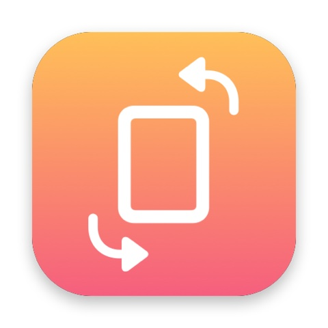

Mac mini を別の部屋に置き、手元の端末から Chrome リモート デスクトップでつないで使っています。手元のモニターを縦置きにしたところ、Mac の画面が小さくしか表示されなくなりました。

結論から書くと、**Mac 側の「システム設定 → ディスプレイ → 回転」を 90° にすれば、縦置きモニターいっぱいに表示されます**。ただ、この設定を毎回開いて切り替えるのが面倒だったので、ワンクリックで「標準 ⇄ 90°」を切り替える小さなアプリを自分用に作りました。後半でその仕組みを紹介します。

<div class="shot-row">
  <figure><figcaption>自分用に作った回転切り替えアプリ。Dock に置いてクリックするだけ</figcaption></figure>
</div>

## 目次

- [何に困っていたか](#何に困っていたか)
- [回転を 90° にすると全画面になる](#回転を-90-にすると全画面になる)
- [切り替えが面倒なのでアプリにした](#切り替えが面倒なのでアプリにした)
- [仕組み — 回転には公開 API がない](#仕組み--回転には公開-api-がない)
- [アプリとして公開しない理由](#アプリとして公開しない理由)
- [自分で作る場合の注意点](#自分で作る場合の注意点)

## 何に困っていたか

リモートデスクトップは、つなぐ先の画面をそのままの縦横比で手元に映します。Mac の画面は横長なので、手元のモニターが縦長だと、横幅に合わせて縮小されます。

フル HD どうしで計算すると、状況がよくわかります。

| | 横 × 縦 | 縦置きモニターでの見え方 |
|---|---|---|
| Mac 側が標準（横長） | 1920 × 1080 | 横幅 1080 に合わせて縮小され、高さは約 608。画面の 3 分の 1 ほどしか使えない |
| Mac 側を 90° 回転（縦長） | 1080 × 1920 | 縮小なしで全画面 |

横長のままだと、縦置きモニターの上下が大きく余り、文字も半分ほどの大きさになります。コードや長い文書を縦に広く見たくて縦置きにしたのに、これでは意味がありません。

## 回転を 90° にすると全画面になる

解決策は、手元ではなく **つなぐ先の Mac の画面を縦長にする** ことでした。

1. Mac mini で「システム設定」を開く
2. 「ディスプレイ」を選ぶ
3. 「回転」を「90°」にする

これで Mac の画面そのものが 1080 × 1920 の縦長になり、縦置きモニターにぴったり収まります。Dock やメニューバーも縦長の画面に合わせて並び直すので、縦置きモニターを Mac に直接つないだときと同じ感覚で使えます。

「回転」の項目は、ディスプレイによっては表示されません。私の環境（Mac mini M4・macOS 27.2）では最初から選べました。

## 切り替えが面倒なのでアプリにした

回転を 90° にしたままでよければ、話はここで終わりです。けれども、横長の画面で使いたい場面もあり、そのたびに標準へ戻す必要がありました。

システム設定を開いて、ディスプレイを選んで、回転のメニューを開いて、角度を選ぶ。4 手かかるうえ、リモート接続中は画面が小さい状態でこの操作をすることになります。これを 1 クリックにしたくて、小さなアプリを作りました。

やることは 1 つだけです。

- 起動すると、回転が標準なら 90° に、90° なら標準に切り替えて、すぐ終了する

常駐せず、ウィンドウも出しません。Dock に置いておけば、クリックするたびに画面の向きが入れ替わります。システム設定から変えたときに出る「この設定のままにしますか」という確認もなく、クリックした瞬間に切り替わります。

自分の Mac mini で 2 回続けて起動したときの結果です。

| | 回転 | 解像度 |
|---|---|---|
| 起動前 | 90° | 1080 × 1920 |
| 1 回目の後 | 標準 | 1920 × 1080 |
| 2 回目の後 | 90° | 1080 × 1920 |

## 仕組み — 回転には公開 API がない

作ってみて意外だったのは、**macOS にはディスプレイの回転を変える公開 API がない** ことでした。解像度は `CGDisplaySetDisplayMode` などの公開 API で変えられますが、回転は対象外です。現在の角度を読む `CGDisplayRotation` はあるのに、書き込む側がありません。

そこで、システム設定が内部で使っている非公開フレームワーク `MonitorPanel` の `MPDisplay` クラスを、実行時に読み込んで呼び出しています。中心部分はこれだけです。

```swift
// 非公開フレームワークを実行時に読み込む
dlopen("/System/Library/PrivateFrameworks/MonitorPanel.framework/MonitorPanel", RTLD_NOW)

// MPDisplay を作り、setOrientation: に角度を渡す
let cls: AnyClass = NSClassFromString("MPDisplay")!
let sel = NSSelectorFromString("setOrientation:")
typealias Fn = @convention(c) (AnyObject, Selector, Int32) -> Void
unsafeBitCast(display.method(for: sel), to: Fn.self)(display, sel, 90)
```

全体の流れは次のとおりです。

1. `CGGetActiveDisplayList` で、つながっているディスプレイの ID を集める
2. ID ごとに `MPDisplay` を `initWithCGSDisplayID:` で作り、`canChangeOrientation` で回転できるかを調べる
3. 回転できる外部ディスプレイがあればそれを、なければ回転できるディスプレイを対象に選ぶ
4. `CGDisplayRotation` で今の角度を読み、0° なら 90 を、それ以外なら 0 を `setOrientation:` に渡す

ヘッダーが公開されていないので、クラス名とメソッド名を文字列で指定し、Objective-C のランタイム経由で呼びます。メソッドが見つからないときは何もせずエラーを表示するようにして、OS の更新で中身が変わっても暴走しないようにしました。

Swift のソースは 1 ファイルで 100 行ほどです。Xcode のプロジェクトは作らず、`swiftc` で直接ビルドして、`Info.plist` と一緒に `.app` の形にまとめています。`Info.plist` で `LSUIElement` を有効にしておくと、起動しても Dock でアイコンが跳ね続けず、一瞬で終わるアプリらしい動きになります。

同じ考え方で、ダークモードや Night Shift を切り替えるメニューバー常駐版も作りました。こちらも公開 API がなく、それぞれ別の非公開フレームワークを呼ぶ必要があります。システム設定の項目には共通の切り替え口がなく、1 つずつ方法を調べることになる、というのが作ってみての実感です。

## アプリとして公開しない理由

このアプリは Mac App Store には出せません。App Store の審査では、非公開 API を使うアプリは却下されるためです。公開 API だけで作り直そうにも、肝心の回転を変える手段がありません。

App Store の外で配る方法もあります。その場合は Developer ID での署名と Apple の公証（ノータリゼーション）が必要です。公証はマルウェアが含まれていないかを Apple が自動で調べる仕組みで、非公開 API の使用は対象になりません。技術的には配布できますが、今回は自分用の道具にとどめ、仕組みの紹介だけにしました。

広告で収益化できないかも考えました。けれども、Mac のネイティブアプリ向けには AdMob の SDK がなく、そもそも起動して一瞬で終わるアプリには広告を出す場所がありません。収益を考えるより、自分の作業が楽になれば十分だと割り切っています。

## 自分で作る場合の注意点

同じものを作ってみたい方に向けて、気をつける点をまとめます。

- **OS の更新で動かなくなる可能性があります**。非公開の仕組みなので、Apple が中身を変えると切り替えられなくなります。クラスやメソッドが見つかるかを毎回確かめてから呼ぶのが安全です
- **動作を確認したのは Mac mini（M4）・macOS 27.2 だけです**。ほかの機種や OS では試していません
- **回転できないディスプレイでは使えません**。システム設定に「回転」の項目が出ないディスプレイは、この方法でも回転できません
- **戻す手段を確保しておきます**。画面が見づらい向きになっても、もう一度アプリを起動するか、システム設定の「ディスプレイ → 回転」で標準に戻せます

縦置きモニターからのリモート接続で画面が小さくて困っている方は、まず Mac 側の回転を 90° にしてみてください。それだけで解決します。切り替えが頻繁なら、ここで紹介した方法で自分用の切り替えアプリを作るのも手です。
